# Informe 1.1: Análisis Exploratorio de Datos (EDA)

| | | | |
| :--- | :--- | :--- | :--- |
| **Proyecto:** | Detección de defectos en granos de maíz con YOLOv11 | **Fecha:** | 13 - 10 - 2026 |
| **Objetivo:** | Objetivo Específico 1, Actividad 1.1 | **Notebook:** | `1.1_eda.ipynb` |
| **Datos analizados:** | `Data_original` (exportación pública de Roboflow Universe, sin modificaciones) | **Figuras:** | `salida/1.1_eda/` |

> Todas las cifras describen el dataset **original**. Las correcciones de etiquetado se documentan en `1.2_limpieza_etiquetas.md`.

---

## 1. Estructura e integridad

El dataset contiene **669 imágenes** y **25 376 anotaciones** en formato YOLO, con 10 clases. Todas las imágenes tienen su archivo de etiquetas y no hay etiquetas sin imagen. La partición original sigue una proporción aproximada de 70/20/10.

| Partición original | Imágenes | Cajas |
| :--- | ---: | ---: |
| Entrenamiento | 459 | 17 238 |
| Validación | 146 | 5 238 |
| Prueba | 64 | 2 900 |
| **Total** | **669** | **25 376** |

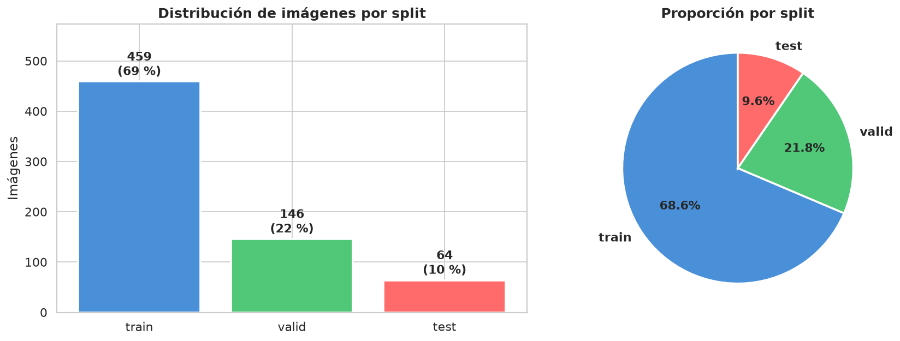

## 2. Distribución de clases

| Clase | Cajas | % |
| :--- | ---: | ---: |
| Broken | 963 | 3.79 |
| Damage | 1 009 | 3.98 |
| Fungus | 3 018 | 11.89 |
| Healthy | 6 616 | 26.07 |
| Immature | 1 623 | 6.40 |
| Inorganic foreign material | 2 619 | 10.32 |
| Organic foreign material | 2 569 | 10.12 |
| Other Edible Seeds | 1 498 | 5.90 |
| Shriveled | 3 662 | 14.43 |
| Weeveled | 1 799 | 7.09 |

El dataset está desbalanceado: `Healthy` concentra la cuarta parte de las cajas, mientras que `Broken` y `Damage` no llegan al 4 % cada una.

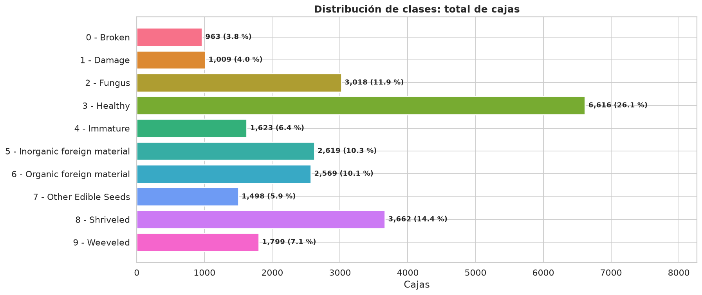

La composición tampoco es homogénea entre particiones. Por ejemplo, `Shriveled` tiene 3 298 de sus 3 662 cajas en entrenamiento, y `Healthy` está sobrerrepresentada en validación.

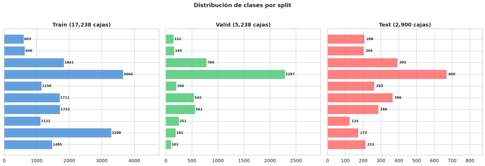

Agrupadas por categoría, las impurezas y las otras semillas suman el 26.3 % de las anotaciones, aunque no son granos de maíz.

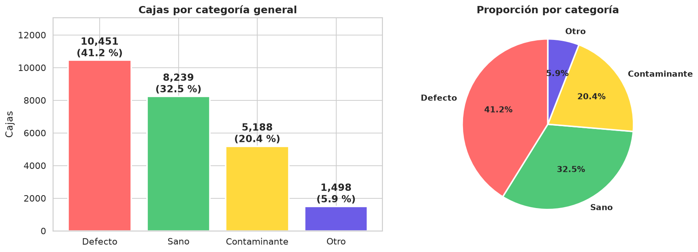

## 3. Imágenes: resolución y tamaño de archivo

Hay **9 resoluciones distintas**, con una media de 13.8 MP. Las más frecuentes son 3468 × 4624 (34.5 %), 3024 × 4032 (30.9 %) y 3120 × 4160 (25.9 %). El 92.8 % de las imágenes es vertical. Los archivos pesan de unos 425 a unos 2 240 KB, con distribuciones similares en las tres particiones.

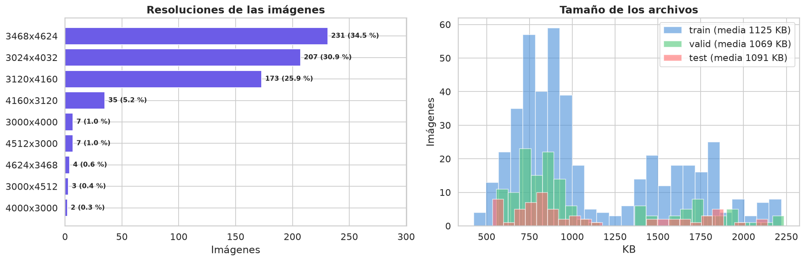

## 4. Cajas: tamaño, forma y tamaño aparente del grano

Las cajas de maíz tienen un tamaño estable dentro de cada clase; las impurezas presentan formas y tamaños mucho más variables.

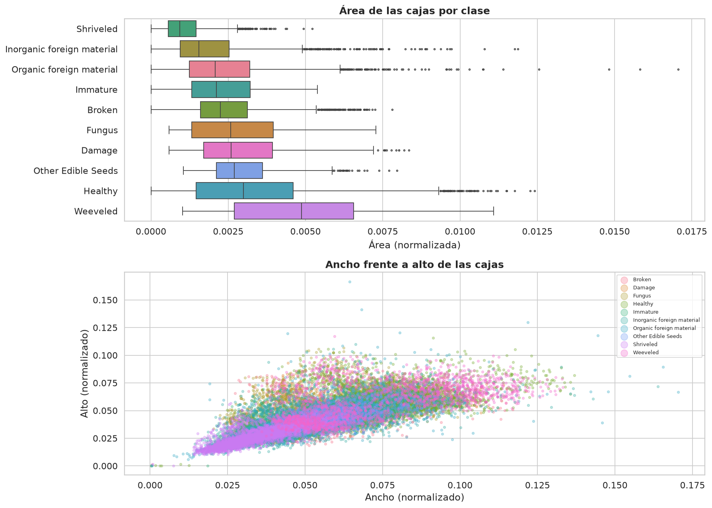

La relación de aspecto de los granos está cerca de 1. Hay **5 cajas con relación de aspecto mayor que 10**: trazos accidentales de casi 1 px de alto.

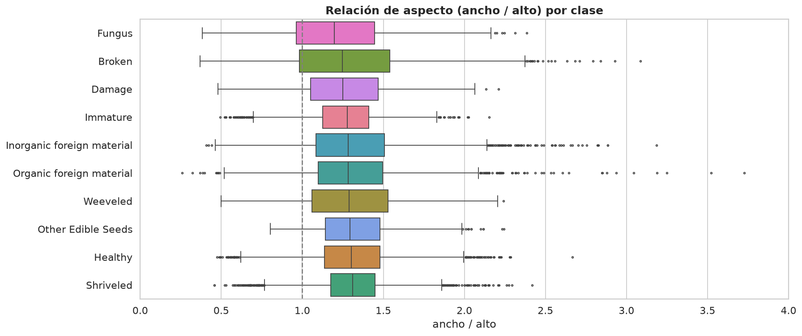

Los granos son pequeños respecto a la imagen. El tamaño que recibe la red depende de la resolución de entrada:

| Resolución de entrada | Lado menor mediano | Percentil 5 | Cajas < 16 px | Cajas < 24 px |
| :---: | :---: | :---: | :---: | :---: |
| 640 px | 24.6 px | 12.3 px | 14.6 % | 47.5 % |
| 960 px | 37.0 px | 18.5 px | 2.7 % | 14.6 % |
| 1280 px | 49.3 px | 24.6 px | 0.4 % | 4.5 % |

A 640 px, uno de cada siete granos queda por debajo de 16 px, el tamaño a partir del cual la cabeza de detección más fina pierde fiabilidad. Esto sugiere que 640 px puede ser insuficiente; la resolución se compara experimentalmente en la Actividad 1.2 (640, 960 y 1280 px).

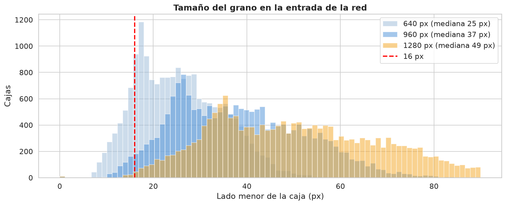

## 5. Distribución espacial

Los objetos se concentran en el centro de la imagen, donde está la hoja o bandeja, sin sesgos de posición por clase.

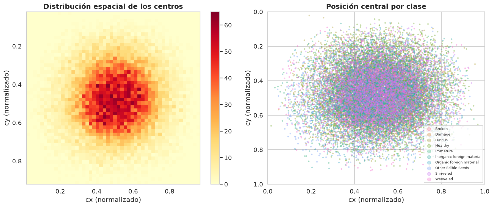

## 6. Densidad y coocurrencia de clases

Cada imagen contiene en promedio **37.9 objetos** (mediana 30, entre 2 y 128).

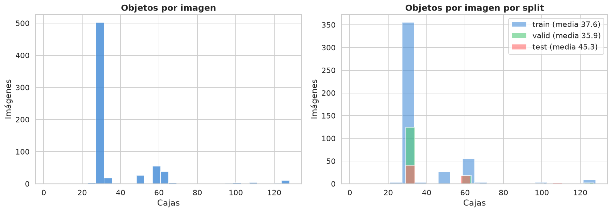

El **97.5 %** de las imágenes contiene una sola clase: cada bandeja se fotografió con un único tipo de grano o de impureza. La matriz de coocurrencia confirma que las clases casi nunca comparten imagen.

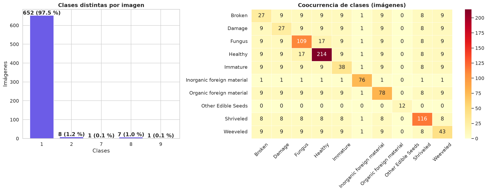

## 7. Muestras con anotaciones

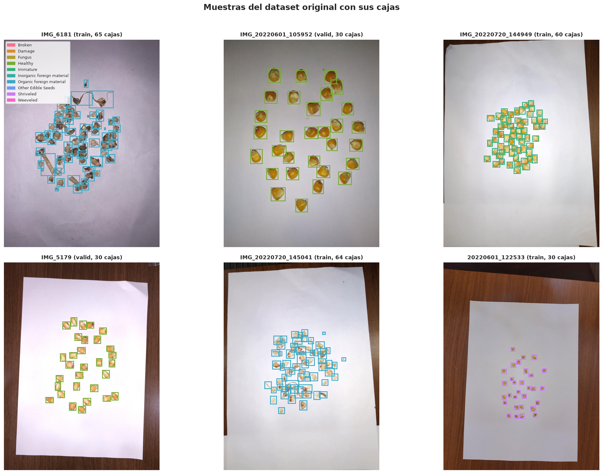

## 8. Sesiones de captura y partición original

Los nombres de archivo codifican la hora de captura (`AAAAMMDD_HHMMSS`) o el contador de la cámara (`IMG_NNNN`, `DSC_NNNN`). Las fotos separadas por 60 s o menos forman una **sesión**: la misma bandeja fotografiada en ráfaga, a veces con los granos reacomodados.

- Hay **64 sesiones**, con una mediana de 5 imágenes y un máximo de 78.
- Dentro de cada sesión, la clase dominante representa la mediana del **100 %** de las cajas: las sesiones son monoclase.
- **36 sesiones (584 imágenes) están repartidas entre varias particiones** en la partición original. Fotos casi idénticas de la misma bandeja aparecen a la vez en entrenamiento y en validación o prueba, lo que infla las métricas de evaluación.

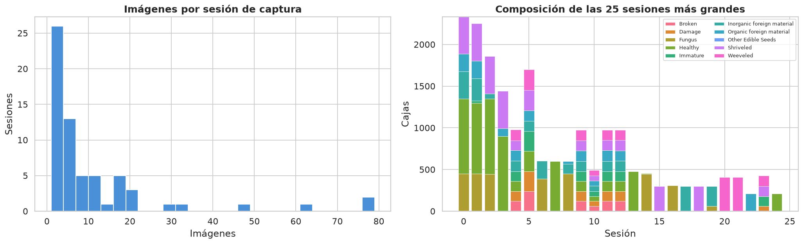

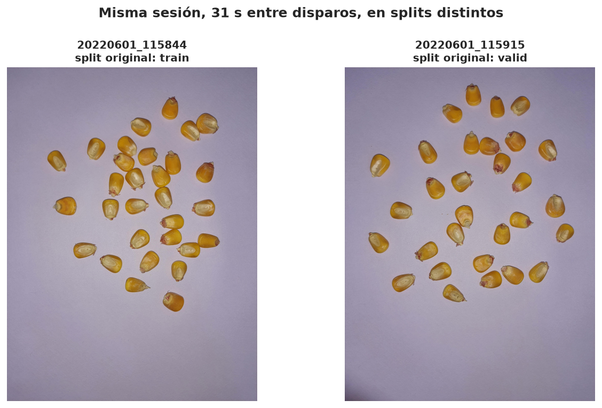

Las sesiones monoclase sugieren además un riesgo de **etiquetado por lote**: toda la bandeja recibe la clase de la muestra, aunque algunos granos no muestren el defecto en su cara visible.

## 9. Calidad del etiquetado

Se aplicaron controles automáticos sobre todas las cajas (`comun.py`). Cada caja se informa una sola vez.

| Problema | Criterio | Casos |
| :--- | :--- | :---: |
| Caja degenerada | Lado menor de menos de 3 px a 960 (trazo accidental) | 13 |
| Cajas duplicadas | Dos cajas sobre el mismo objeto (IoU > 0.85) | 16 |
| Tamaño atípico | Área anormal para su clase (z robusto > 3.5) | 13 |
| Clase rara en sesión casi monoclase | Clase con menos del 3 % de las cajas en una sesión dominada por otra | 13 |
| Posible etiquetado incompleto | Imagen con muchas menos cajas que la mediana de su sesión | 1 |
| **Total** | | **56 problemas en 39 imágenes** |

Ejemplos (izquierda: imagen completa con el problema rodeado; derecha: recorte ampliado; caja señalada en rojo, su duplicada en azul):

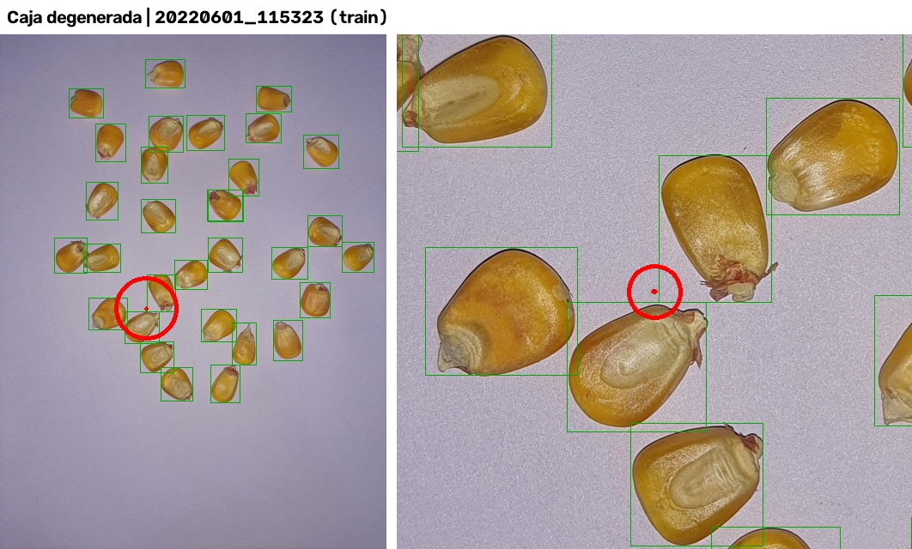

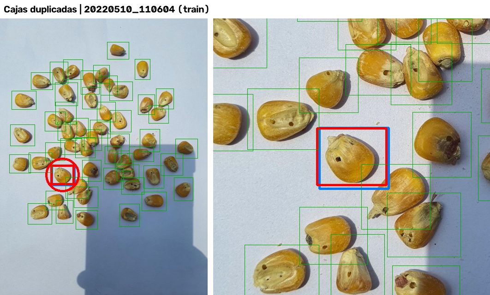

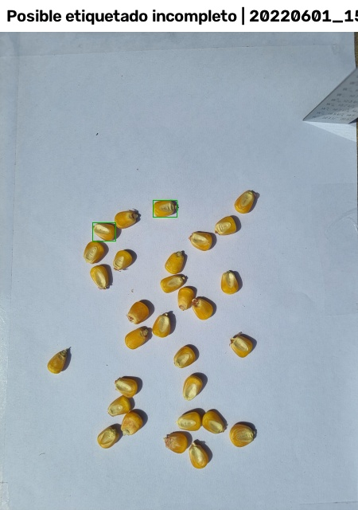

**Límite de la detección automática.** Los controles detectan cajas mal trazadas, duplicadas o de tamaño anómalo, y las omisiones groseras. No detectan omisiones parciales ni errores de clase en granos individuales, que exigen revisión visual.

## 10. Propuesta de consolidación de clases

1. **Excluir `Other Edible Seeds`:** imágenes con solo semillas de otra especie.
2. **Excluir las impurezas** (`Inorganic` y `Organic foreign material`): objetos heterogéneos, a menudo apilados, que no son granos.
3. **Unir `Immature` con `Healthy`:** el Codex CXS 153-1985 no cuenta la inmadurez entre los granos defectuosos.
4. **Agrupar en `Defect`** `Broken`, `Damage`, `Fungus`, `Shriveled` y `Weeveled`.

Se excluyen así 6 686 cajas (26.3 %), y las dos clases finales quedan cerca del equilibrio.

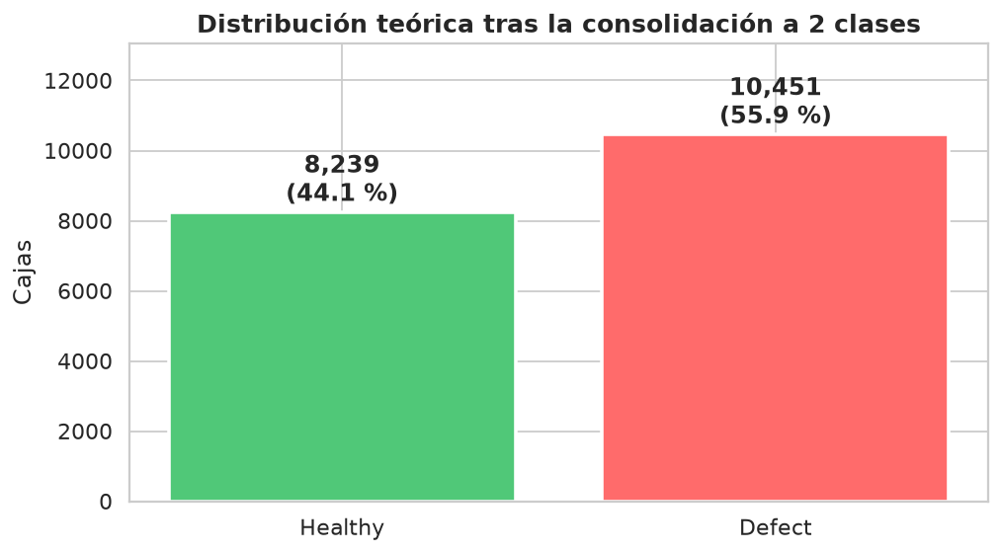

## 11. Conclusiones

1. **Clases:** fuerte desbalance entre subtipos; tras la consolidación binaria, las dos clases quedan cerca del equilibrio.
2. **Imágenes:** 9 resoluciones de alrededor de 13.8 MP; hay que llevarlas a una resolución común; por el tamaño de los granos, conviene comparar 640, 960 y 1280 px.
3. **Escenas monoclase:** el 97.5 % de las imágenes tiene una sola clase.
4. **Partición original con fuga:** hay que re-particionar con la sesión o el lote de captura como unidad indivisible.
5. **Etiquetado:** hay cajas degeneradas, duplicadas, de tamaño anómalo y alguna imagen casi sin etiquetar; se corrigen en Roboflow (`1.2_limpieza_etiquetas.md`).
