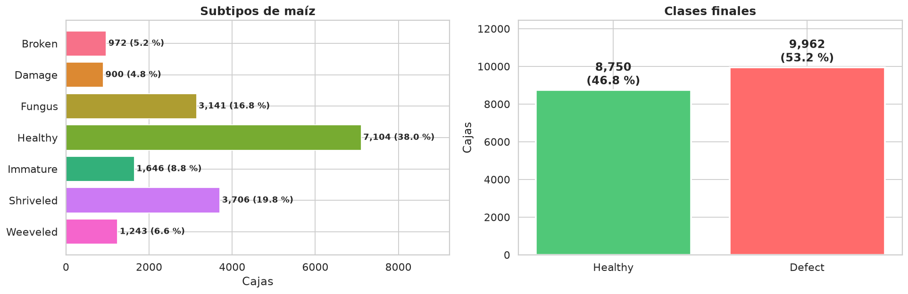
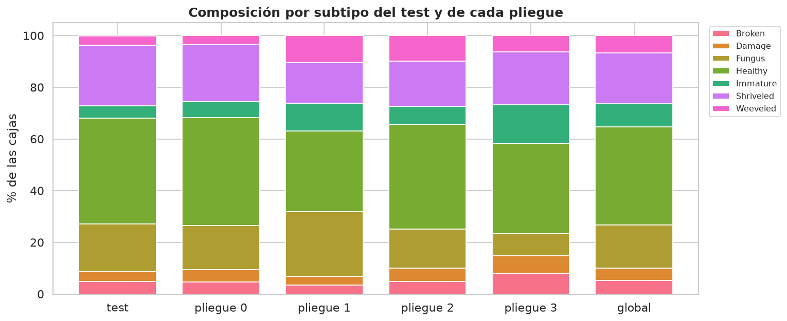
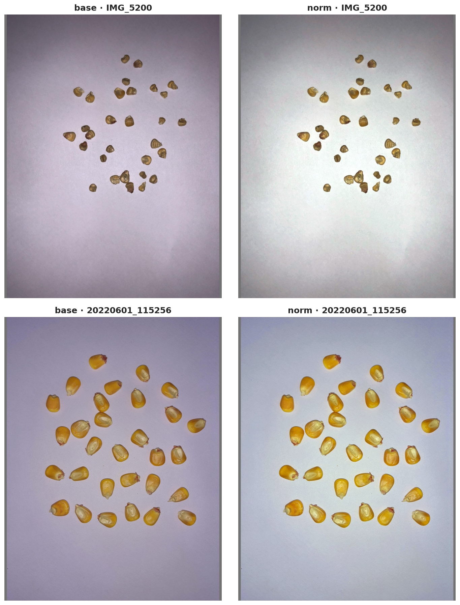
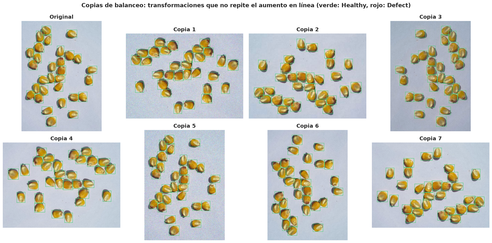
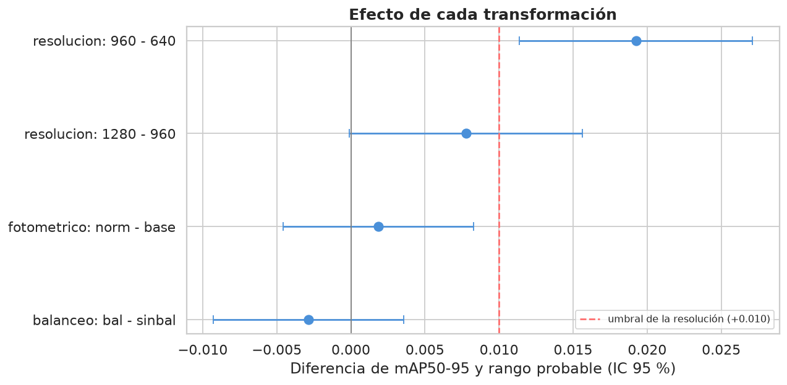
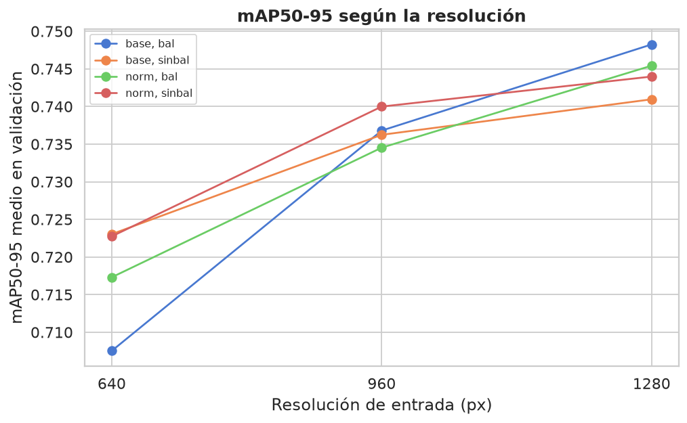
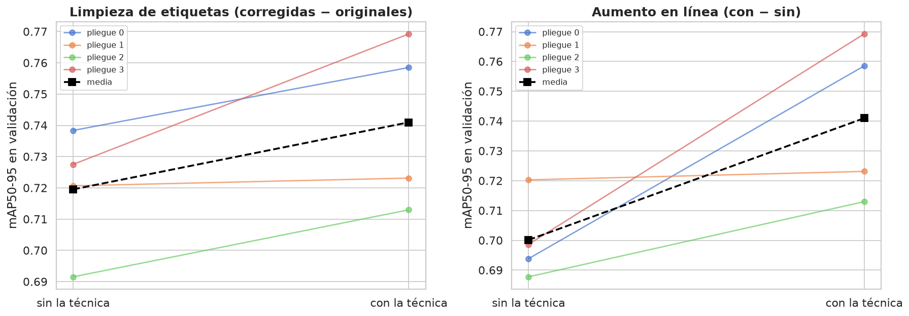

# Informe 1.2: Ingeniería de Datos

| | | | |
| :--- | :--- | :--- | :--- |
| **Proyecto:** | Detección de defectos en granos de maíz con YOLOv11 | **Fecha:** | 13 - 10 - 2026 |
| **Objetivo:** | Objetivo Específico 1, Actividad 1.2 | **Notebooks:** | `1.2_ingenieria_datos.ipynb`, `1.2_experimentos.ipynb` |
| **Entrada:** | `datos/Data_corr_v6` (669 imágenes con las etiquetas corregidas) | **Figuras:** | `salida/1.2_ingenieria_datos/` |

---

## 1. Planteamiento

El PIIC pide "determinar qué transformaciones benefician realmente al conjunto de datos", probando la limpieza, la estandarización, la normalización, el balanceo y el aumento de datos. El criterio seguido es **decidir de forma analítica lo que no requiere entrenar y experimentar solo con lo que sí**.

| Transformación | Cómo se decide | Resultado |
| :--- | :--- | :--- |
| Limpieza de etiquetas | Corrección en Roboflow (`1.2_limpieza_etiquetas.md`) y experimento complementario | **Aplicada**: mejora en los 4 pliegues (sección 9.5) |
| Consolidación a 2 clases | Analítica (EDA y Codex CXS 153-1985) | `Healthy` / `Defect` |
| Partición | Por lote de captura | Test fijo + 4 pliegues |
| Estandarización geométrica | Analítica (requisito de YOLO) | Letterbox a múltiplo de 32 |
| Normalización de píxeles a [0, 1] | La hace el dataloader de Ultralytics | — |
| Resolución (640 / 960 / 1280) | Experimento | **1280** (desviación declarada, sección 9.4) |
| Normalización fotométrica (Gray World) | Experimento | **Sin normalizar** (`base`) |
| Balanceo de clases | Experimento | **Sin balanceo** |
| Aumento de datos | Analítica (en línea, no offline) y experimento complementario | **En línea**: mejora en los 4 pliegues (sección 9.5) |

## 2. Consolidación a 2 clases

`Healthy` + `Immature` → **Healthy**; `Broken`, `Damage`, `Fungus`, `Shriveled` y `Weeveled` → **Defect**.
- **Se retiran 156 imágenes** que solo contienen impurezas u otras semillas. Dejarlas con etiquetas vacías enseñaría a la red a ignorar objetos de forma parecida a los granos. Quedan reservadas como posibles fondos negativos para el OE2.
- **En 9 imágenes mixtas** se conservan solo las cajas de maíz.

Resultado: **513 imágenes y 18 712 cajas**, con una razón Defect/Healthy de 1.14.

## 3. Partición por lote de captura

La partición original tenía fuga (fotos de la misma bandeja en particiones distintas). Además, fotos tomadas con pocos minutos de diferencia suelen ser el mismo lote de granos reacomodado. Por eso la unidad indivisible de partición es el **lote**: fotos separadas por 5 minutos o menos, o hasta 5 posiciones de contador. Hay 25 lotes.

- **Test (~15 %):** lotes completos, estratificados por subtipo. **No se usa en ninguna decisión** hasta la evaluación final del OE2.
- **Desarrollo:** 4 pliegues por lote para la validación cruzada.
- **Elección de la semilla:** entre 300 semillas de `StratifiedGroupKFold`, la que mejor representa al subtipo peor cubierto. Solo se usan etiquetas.

| Conjunto | Imágenes | Lotes | Cajas | % Healthy |
| :--- | ---: | ---: | ---: | ---: |
| Test | 70 | 3 | 2 467 | 45.8 |
| Pliegue 0 | 148 | 6 | 5 305 | 48.0 |
| Pliegue 1 | 101 | 6 | 3 726 | 41.8 |
| Pliegue 2 | 98 | 5 | 3 486 | 47.5 |
| Pliegue 3 | 96 | 5 | 3 728 | 49.9 |
| **Global** | **513** | **25** | **18 712** | **46.8** |

Ningún lote queda repartido entre conjuntos, y todos los subtipos están presentes en el test y en cada pliegue. **Limitación:** el test procede de solo 3 lotes, por el número reducido de lotes del dataset original. La prueba con fotografías nuevas de la ampliación lo complementará en la evaluación final.

## 4. Estandarización: letterbox y resolución

Las imágenes (9 resoluciones de unos 13.8 MP) se llevan a una resolución común con letterbox:
- se escala el lado mayor conservando la proporción;
- se rellena con gris (114, 114, 114), el mismo valor de Ultralytics, hasta un múltiplo de 32.

Así no se deforma el grano ni se pierde ninguna caja. Se generan tres resoluciones: **640 px**, la de la iteración anterior, y las dos candidatas del EDA, **960 y 1280 px**. A 640 px, el 47.5 % de los granos mide menos de 24 px; a 960, el 14.6 %; a 1280, el 4.5 %.

La normalización de píxeles a [0, 1] no se aplica en disco: la hace el dataloader de Ultralytics al cargar cada lote.

## 5. Normalización fotométrica

Variante `norm`: balance de blancos *Gray World*, brillo objetivo de 175, contraste de 1.1 y saturación de 1.15. Corrige el tinte violáceo de algunas capturas, pero también altera el color de las que ya estaban bien. Su efecto se mide en el experimento.

## 6. Balanceo de clases

Sobremuestreo por déficit **dentro de cada pliegue**: se copian imágenes de la clase deficitaria hasta igualar las cajas de `Healthy` y `Defect`.

| Pliegue de validación | Imágenes de entrenamiento | Healthy | Defect | Defect / Healthy | Copias |
| :---: | ---: | ---: | ---: | :---: | ---: |
| 0 | 295 | 5 074 | 5 866 | 1.16 | 16 |
| 1 | 342 | 6 061 | 6 458 | 1.07 | 6 |
| 2 | 345 | 5 963 | 6 796 | 1.14 | 17 |
| 3 | 347 | 5 759 | 6 758 | 1.17 | 26 |

Tras la consolidación, las clases ya están cerca del equilibrio, así que el balanceo añade pocas imágenes (2 a 8 %).

Las copias **no repiten el aumento en línea de Ultralytics**: usan solo transformaciones que Ultralytics no aplica por defecto.

| Transformación de las copias | Qué aporta | ¿Ultralytics la aplica por defecto? |
| :--- | :--- | :---: |
| Rotación de 90, 180 o 270° | Orientación arbitraria del grano (cajas exactas, sin recorte) | No (`degrees = 0`) |
| Volteo vertical | Completa las simetrías de la toma cenital | No (`flipud = 0`) |
| Ruido gaussiano, compresión JPEG, gamma, curva tonal o nitidez (una de ellas) | Variaciones de sensor, compresión y respuesta de la cámara | No (Ultralytics solo varía HSV) |

## 7. Aumento de datos: en línea

Ultralytics aplica aumento **en línea** en cada época: mosaico, volteo horizontal, escala, traslación y variación HSV. Cada imagen se ve con una variante distinta en cada época, sin ocupar disco. No se genera un dataset aumentado offline:

1. **Sería redundante:** copias offline con esas mismas transformaciones solo repiten, de forma congelada y con menos variedad, lo que el entrenamiento ya hace.
2. **Evita la fuga:** en la literatura de maíz es habitual multiplicar el dataset offline, a veces antes de partirlo, de modo que versiones de una misma imagen acaban en entrenamiento y en prueba. Aquí, las únicas copias offline son las del balanceo, y se generan dentro de cada pliegue.

El aporte del aumento en línea se comprueba experimentalmente en la sección 9.5.

## 8. Diseño experimental

**Diseño factorial completo 3 × 2 × 2:** resolución (640 / 960 / 1280) × fotométrico (`base` / `norm`) × balanceo (no / sí). Son 12 configuraciones × 4 pliegues = **48 corridas**, y se evalúa el efecto de cada factor y de sus combinaciones (interacciones).

- **Protocolo fijo:** YOLOv11s preentrenado en COCO, SGD con `lr0 = 0.01`, aumento en línea por defecto de Ultralytics, lote 8, semilla 42, sin parada temprana. Sin balanceo se entrenan 50 épocas; con balanceo, las épocas se reducen en proporción a las copias añadidas (mismo número de iteraciones).
- **Métrica de decisión:** mAP50-95 en el pliegue de validación. Se registran también mAP50, P, R, el acierto por subtipo y el MAE de conteo.
- **Análisis:** modelo lineal con el pliegue como bloque. Para cada factor se mide si influye en el mAP50-95 y la diferencia entre niveles consecutivos, con su valor p. Una diferencia es **significativa** si su valor p es menor que 0.05, es decir, si es poco probable que se deba al azar.
- **Reglas de decisión:**
  - **Resolución:** se parte de 640 y se sube al nivel siguiente solo si mejora al menos +0.010 de mAP50-95 y la mejora es significativa.
  - **`norm`** o **balanceo:** se adoptan solo si mejoran de forma significativa.
  - En los demás casos, se elige la opción más simple.
- **Experimentos complementarios:** la limpieza de etiquetas y el aumento en línea se aplican sin pasar por el diseño factorial. Para comprobar su aporte, se entrena la configuración elegida quitando cada técnica (4 corridas cada uno) y se compara, pliegue a pliegue, con las corridas del diseño de esa configuración:
  - **Limpieza:** entrenamiento con las etiquetas originales (v0) en lugar de las corregidas, con las mismas imágenes; la validación usa siempre las corregidas.
  - **Aumento:** entrenamiento sin ningún aumento de Ultralytics (mosaico, volteo, escala, traslación, HSV y sus transformaciones de Albumentations).
- **Ejecución:** en Google Colab con la misma GPU (NVIDIA A100 de 40 GB) para las 56 corridas (48 del diseño y 8 complementarias), de 3.3 a 5 minutos cada una. De cada corrida se conserva su carpeta de Ultralytics (curvas, matrices de confusión y `best.pt` como único peso) y una fila de métricas en `resultados/experimentos.csv`.

## 9. Resultados

Se completaron las 48 corridas del diseño (una por configuración y pliegue) y las 8 complementarias.

### 9.1. ¿Qué factores influyen?

| Factor o combinación | Valor p | ¿Influye? |
| :--- | :---: | :---: |
| **Resolución** | **< 0.001** | **Sí** |
| Fotométrico | 0.560 | No |
| Balanceo | 0.372 | No |
| Resolución × fotométrico | 0.810 | No |
| Resolución × balanceo | 0.173 | No |
| Fotométrico × balanceo | 0.925 | No |
| Resolución × fotométrico × balanceo | 0.496 | No |

La resolución es el único factor que influye en el mAP50-95. Ninguna interacción es significativa, así que cada factor puede decidirse por separado.

### 9.2. Diferencias entre niveles

| Paso | Diferencia de mAP50-95 | Valor p | ¿Significativa? |
| :--- | :---: | :---: | :---: |
| Resolución 640 → 960 | **+0.0192** | **< 0.001** | **Sí** |
| Resolución 960 → 1280 | +0.0078 | 0.053 | No (en el límite) |
| Fotométrico `base` → `norm` | +0.0019 | 0.560 | No |
| Balanceo `sinbal` → `bal` | −0.0029 | 0.372 | No |

En el gráfico, cada barra es el rango probable de la diferencia (intervalo de confianza del 95 %). La de 960 → 1280 apenas toca el 0: la mejora es probable, pero no queda demostrada al nivel exigido.

El mAP50-95 crece con la resolución en las cuatro combinaciones de los otros dos factores. El salto de 640 a 960 es grande y claro; el de 960 a 1280 es menor, pero tiene la misma dirección.

### 9.3. Medias por resolución y por configuración

| Resolución | mAP50-95 | MAE de conteo | Acierto `Immature` | Acierto `Weeveled` | Minutos por corrida | VRAM (lote 8) |
| :---: | :---: | :---: | :---: | :---: | :---: | :---: |
| 640 | 0.718 | 0.72 | 0.72 | 0.76 | 3.5 | 3.0 GB |
| 960 | 0.737 | 0.42 | 0.79 | 0.80 | 4.0 | 6.4 GB |
| **1280** | **0.745** | **0.34** | **0.82** | **0.86** | 4.9 | 11.7 GB |

| Resolución | Fotométrico | Balanceo | mAP50-95 | mAP50 | Precisión | Recall | MAE de conteo |
| :---: | :---: | :---: | :---: | :---: | :---: | :---: | :---: |
| 1280 | base | bal | 0.748 | 0.980 | 0.934 | 0.945 | 0.34 |
| 1280 | norm | bal | 0.745 | 0.970 | 0.892 | 0.938 | 0.34 |
| 1280 | norm | sinbal | 0.744 | 0.973 | 0.895 | 0.936 | 0.36 |
| **1280** | **base** | **sinbal** | **0.741** | **0.980** | **0.936** | **0.935** | **0.33** |
| 960 | norm | sinbal | 0.740 | 0.978 | 0.911 | 0.941 | 0.36 |
| 960 | base | bal | 0.737 | 0.975 | 0.925 | 0.922 | 0.44 |
| 960 | base | sinbal | 0.736 | 0.974 | 0.910 | 0.940 | 0.38 |
| 960 | norm | bal | 0.735 | 0.970 | 0.908 | 0.929 | 0.51 |
| 640 | base | sinbal | 0.723 | 0.970 | 0.897 | 0.925 | 0.78 |
| 640 | norm | sinbal | 0.723 | 0.969 | 0.909 | 0.908 | 0.74 |
| 640 | norm | bal | 0.717 | 0.955 | 0.878 | 0.919 | 0.68 |
| 640 | base | bal | 0.708 | 0.959 | 0.892 | 0.905 | 0.70 |

Promedio de los 4 pliegues. La variación entre pliegues (de 0.712 en el pliegue 2 a 0.755 en el pliegue 3) es mayor que la que hay entre configuraciones de la misma resolución, lo que justifica analizar con el pliegue como bloque.

### 9.4. Decisión

| Factor | Regla | Resultado | Según la regla | Decisión adoptada |
| :--- | :--- | :--- | :---: | :---: |
| Resolución | Subir de nivel si mejora +0.010 de forma significativa | 640 → 960: +0.0192, significativa (cumple); 960 → 1280: +0.0078, p = 0.053 (no cumple) | 960 | **1280** |
| Fotométrico | Mejora significativa | +0.0019, no significativa | `base` | **`base`** |
| Balanceo | Mejora significativa | −0.0029, no significativa | `sinbal` | **`sinbal`** |

**Configuración elegida: 1280 px, sin normalización fotométrica y sin balanceo** (`resultados/decision.json`).

**Desviación declarada de la regla de resolución.** La regla conduce a 960. Se adopta 1280 por cuatro motivos:

1. **Es la resolución con la media más alta** y supera a 960 en 12 de las 16 comparaciones pareadas (misma configuración y pliegue). La diferencia (+0.0078) queda en el límite de la significación (p = 0.053), así que la evidencia a su favor es moderada.
2. **El mAP50-95 crece con la resolución**, de forma coherente con el EDA: los granos de menos de 24 px son el 47.5 % a 640, el 14.6 % a 960 y el 4.5 % a 1280 (informe 1.1, sección 4).
3. **Las métricas de aplicación mejoran en la misma dirección**, aunque ninguna es significativa por separado:

| Métrica | Diferencia de 1280 frente a 960 | Valor p |
| :--- | :---: | :---: |
| mAP50-95 | +0.0078 | 0.053 |
| MAE de conteo (granos por imagen) | −0.084 | 0.083 |
| Acierto de `Weeveled` | +0.057 | 0.337 |
| Acierto de `Immature` | +0.033 | 0.449 |

4. **El costo adicional es asumible:** ~20 % más de tiempo de entrenamiento. Con lote 8 requiere unos 12 GB de VRAM, por lo que los entrenamientos a 1280 se ejecutan en la nube.

La decisión se toma con los pliegues de validación; el conjunto de prueba no interviene, así que la evaluación final del OE2 no tiene sesgo.

**Los otros dos factores:**
- **Normalización fotométrica.** No mejora el mAP50-95 y **reduce la precisión** de forma significativa (−0.017, valor p = 0.039): hay más detecciones falsas. Una explicación plausible es que la corrección altera el color, que es una de las señales que distinguen los defectos.
- **Balanceo.** No mejora el mAP50-95 y **reduce el mAP50** de forma significativa (−0.006, valor p = 0.012). Tras la consolidación, la razón Defect/Healthy (1.07 a 1.17) ya era cercana a 1, y las copias añadían solo entre el 2 y el 8 % de imágenes.

### 9.5. Experimentos complementarios: limpieza y aumento

Sobre la configuración elegida (1280 px, `base`, sin balanceo) se entrenó quitando cada técnica y se comparó, pliegue a pliegue, con las corridas del diseño de esa configuración. La **diferencia** es *con la técnica − sin ella*.

| Técnica | Métrica | Con la técnica | Sin la técnica | Diferencia | Pliegues a favor | Valor p |
| :--- | :--- | :---: | :---: | :---: | :---: | :---: |
| **Limpieza de etiquetas** | mAP50-95 | 0.741 | 0.720 | **+0.021** | **4/4** | 0.076 |
| | mAP50 | 0.980 | 0.951 | **+0.029** | 4/4 | **0.039** |
| | Precisión | 0.936 | 0.897 | +0.039 | 3/4 | 0.322 |
| | MAE de conteo | 0.33 | 0.31 | +0.02 (sin mejora) | 2/4 | 0.528 |
| **Aumento en línea** | mAP50-95 | 0.741 | 0.700 | **+0.041** | **4/4** | 0.086 |
| | mAP50 | 0.980 | 0.953 | +0.027 | 4/4 | 0.133 |
| | Precisión | 0.936 | 0.880 | +0.056 | 3/4 | 0.167 |
| | MAE de conteo | 0.33 | 0.46 | **−0.13** (mejora) | **4/4** | **0.007** |

- **Las dos técnicas mejoran el mAP50-95 en los 4 pliegues.** Con solo 4 pares, la prueba t tiene poca potencia y el valor p queda cerca de 0.08; aun así, que la mejora se repita en los 4 pliegues tiene una probabilidad de 1 entre 16 si en realidad no hubiera efecto.
- **Limpieza.** Corregir las etiquetas mejora el mAP50 de forma significativa y aumenta la precisión: el modelo entrenado con las etiquetas originales marca más granos como defectuosos, ya que en esas etiquetas toda la bandeja de gorgojo figuraba como `Weeveled`, tuviera o no el orificio visible. Por eso su acierto en `Weeveled` es mayor (+0.085), a costa de más falsos defectos en los demás subtipos. El conteo no cambia, porque la limpieza afecta sobre todo a la clase de los granos, no a cuántos hay.
- **Aumento en línea.** Es la técnica con mayor efecto: +0.041 de mAP50-95 y un error de conteo significativamente menor (0.33 frente a 0.46 granos por imagen). Mejora el acierto de casi todos los subtipos, sobre todo `Weeveled` (+0.11) y `Shriveled` (+0.08); `Fungus` no cambia.

Ambas técnicas quedan validadas experimentalmente y se mantienen en el dataset final.

### 9.6. Observaciones para el OE2

- **Subtipos difíciles.** `Immature` y `Weeveled` son los subtipos con menor acierto en todas las resoluciones (0.82 y 0.86 a 1280); los demás superan 0.91. Es el primer aspecto que conviene revisar si el modelo final falla.
- **Convergencia.** El mejor epoch está, en mediana, en el 42 de 50, y el mAP50-95 de validación aún sube en las últimas épocas (+0.010 de media entre los bloques de 5 épocas finales), con oscilaciones de una época a otra. En el entrenamiento del OE2 conviene dar más épocas.
- **Sesgo común.** El `best.pt` de cada corrida se elige con el mismo pliegue con el que se evalúa, lo que sobreestima ligeramente todas las métricas. El sesgo afecta por igual a las 12 configuraciones, así que no altera la comparación, pero estas cifras no son una estimación del rendimiento final: esa la dará el conjunto de prueba en el OE2.
