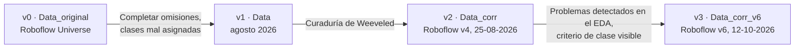
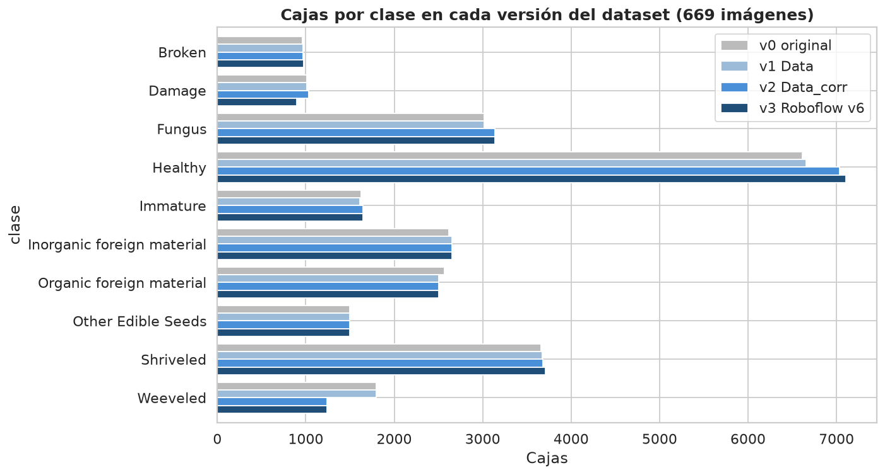
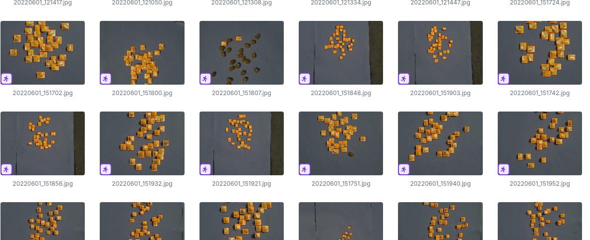
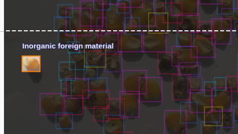
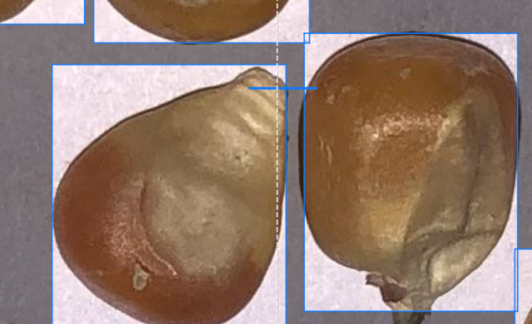
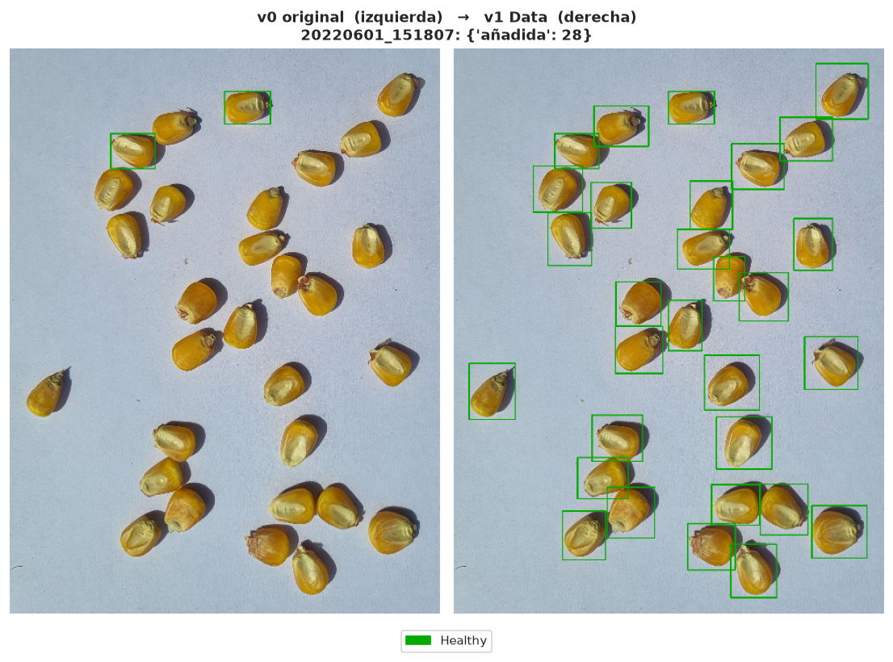
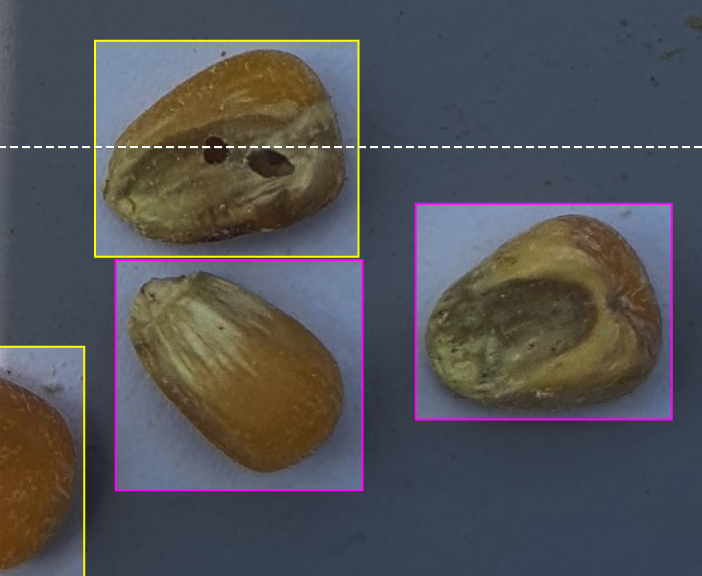
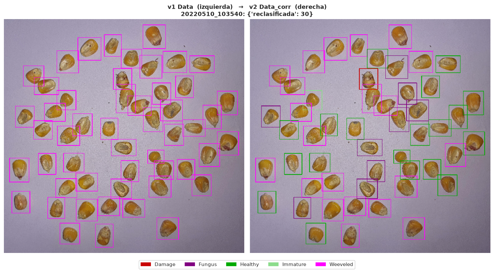
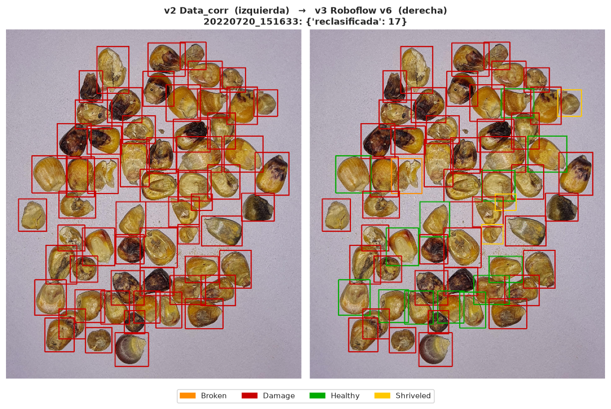

# Informe 1.2 (Limpieza): Corrección del Etiquetado y Versiones del Dataset

| | | | |
| :--- | :--- | :--- | :--- |
| **Proyecto:** | Detección de defectos en granos de maíz con YOLOv11 | **Fecha:** | 12 - 10 - 2026 |
| **Objetivo:** | Objetivo Específico 1, Actividad 1.2 (limpieza) | **Notebook:** | `1.2_limpieza_etiquetas.ipynb` |
| **Resultado:** | `datos/Data_corr_v6` (669 imágenes originales, etiquetas corregidas) | **Figuras:** | `salida/1.2_limpieza/` |

---

## 1. Versiones del dataset

El etiquetado se corrigió en tres rondas, todas en la plataforma Roboflow, sobre las mismas 669 imágenes. Cada ronda generó una nueva versión exportada.

| Versión | Carpeta | Contenido |
| :--- | :--- | :--- |
| v0 | `datos/originales/Data_original` | Exportación pública original |
| v1 | `datos/originales/Data` | Primera re-anotación |
| v2 | `datos/originales/Data_corr` | Curaduría de `Weeveled` |
| v3 | `datos/Data_corr_v6` | Corrección guiada por el EDA (exportación v6 de Roboflow, solo las 669 imágenes originales) |

Las imágenes se emparejan entre versiones por su nombre base, porque Roboflow cambia el sufijo `.rf.<hash>` en cada exportación. Las cajas se emparejan por IoU ≥ 0.5 dentro de cada imagen.

## 2. Resumen cuantitativo

### 2.1. Cajas por clase en cada versión

| Clase | v0 | v1 | v2 | v3 |
| :--- | ---: | ---: | ---: | ---: |
| Broken | 963 | 966 | 966 | 972 |
| Damage | 1 009 | 1 008 | 1 034 | 900 |
| Fungus | 3 018 | 3 018 | 3 136 | 3 141 |
| Healthy | 6 616 | 6 654 | 7 035 | 7 104 |
| Immature | 1 623 | 1 613 | 1 643 | 1 646 |
| Inorganic foreign material | 2 619 | 2 652 | 2 652 | 2 650 |
| Organic foreign material | 2 569 | 2 505 | 2 505 | 2 505 |
| Other Edible Seeds | 1 498 | 1 498 | 1 498 | 1 497 |
| Shriveled | 3 662 | 3 674 | 3 679 | 3 706 |
| Weeveled | 1 799 | 1 798 | 1 238 | 1 243 |
| **Total** | **25 376** | **25 386** | **25 386** | **25 364** |

### 2.2. Cambios entre versiones

| Transición | Imágenes modificadas | Añadidas | Eliminadas | Reclasificadas | Reajustadas |
| :--- | :---: | :---: | :---: | :---: | :---: |
| v0 → v1 | 90 | 130 | 120 | 52 | 756 |
| v1 → v2 | 36 | 14 | 14 | 559 | 631 |
| v2 → v3 | 44 | 0 | 22 | 148 | 25 |

*Reajustada: misma caja y clase, pero con una forma distinta (IoU < 0.95 con la anterior).*

### 2.3. Problemas detectables en cada versión

Los controles automáticos del EDA, aplicados a cada versión, muestran el efecto de las correcciones:

| Problema | v0 | v1 | v2 | v3 |
| :--- | :---: | :---: | :---: | :---: |
| Caja degenerada | 13 | 6 | 6 | 0 |
| Cajas duplicadas | 16 | 16 | 16 | 0 |
| Tamaño atípico | 13 | 0 | 0 | 0 |
| Clase rara en sesión casi monoclase | 13 | 14 | 14 | 2 |
| Posible etiquetado incompleto | 1 | 0 | 0 | 0 |
| **Total** | **56** | **36** | **36** | **2** |

Las cajas duplicadas y las degeneradas más pequeñas sobrevivieron a las dos primeras rondas, porque se buscaban a ojo. Desaparecieron en la v3, cuando se usó la detección automática del EDA.

## 3. Ronda 1 (v0 → v1): primera re-anotación

**Problemas corregidos:**
- **Imágenes con granos sin etiquetar.** Algunas capturas tenían 2 o 3 cajas sobre decenas de granos. Se añadieron 130 cajas en 43 imágenes; el caso extremo es `20220601_151807`, con 28 cajas añadidas.
- **Clases mal asignadas.** Por ejemplo, granos de maíz etiquetados como `Inorganic foreign material`. Se reclasificaron 52 cajas, la mayoría impurezas orgánicas que eran inorgánicas (30).
- **Trazos accidentales** con forma de línea (relación de aspecto > 10).
- **Reajuste** de 756 cajas, en su mayoría de impurezas.

## 4. Ronda 2 (v1 → v2): curaduría de `Weeveled`

El EDA mostró que las bandejas eran monoclase. En las muestras con gorgojo, todos los granos se habían etiquetado `Weeveled`, aunque en muchos el orificio no queda en la cara visible. Exigir a la red que reconozca un defecto invisible introduce supervisión contradictoria.

**Criterio aplicado:** un grano es `Weeveled` solo si el orificio o túnel es visible en la cara expuesta; si no, se etiqueta según lo que se ve. Se reclasificaron 559 cajas: 381 a `Healthy`, 117 a `Fungus`, 29 a `Immature`, 26 a `Damage` y 5 a `Shriveled`.

## 5. Ronda 3 (v2 → v3): corrección guiada por el EDA

La detección automática del EDA (sección 9 del informe 1.1) dio una lista de problemas con el nombre de cada imagen en Roboflow y una imagen de evidencia. Con ella:

- **Se eliminaron 22 cajas:** las 16 duplicadas y las 6 degeneradas.
- **Se reclasificaron 148 cajas** aplicando el mismo criterio de la ronda 2 (la clase corresponde a lo visible en la cara expuesta del grano) a `Damage` y a las clases minoritarias de cada bandeja:

| Antes | Después | Cajas |
| :--- | :--- | :---: |
| Damage | Healthy | 87 |
| Damage | Shriveled | 30 |
| Healthy | Fungus | 14 |
| Damage | Broken | 7 |
| Damage | Weeveled | 6 |
| Damage | Immature | 4 |

Tras esta ronda, los problemas detectables bajan de 36 a **2**: una caja `Broken` y una `Shriveled` en una bandeja de `Damage` (`20220720_154640`), compatibles con una mezcla real de granos.

## 6. Dataset resultante

`datos/Data_corr_v6` contiene las **669 imágenes originales** con las etiquetas de la versión 6 de Roboflow. Las 93 fotografías nuevas de smartphone de esa exportación se excluyen; se incorporarán en la ampliación del dataset.

| Partición (Roboflow v6) | Imágenes |
| :--- | ---: |
| Entrenamiento | 468 |
| Validación | 134 |
| Prueba | 67 |

Esta partición es la de Roboflow, que tiene fuga entre sesiones (informe 1.1, sección 8). La partición definitiva por sesión de captura se hace en la siguiente etapa.

**Validación experimental.** Entrenar con estas etiquetas en lugar de las originales mejora el mAP50-95 en los 4 pliegues de validación (+0.021) y el mAP50 de forma significativa (+0.029); ver el informe 1.2, sección 9.5.
