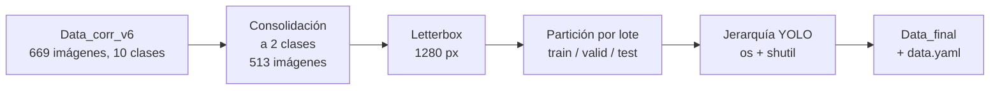
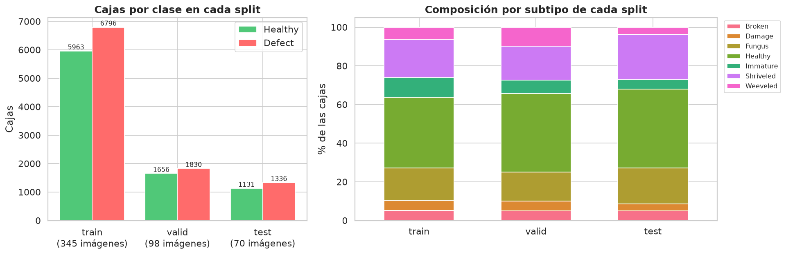
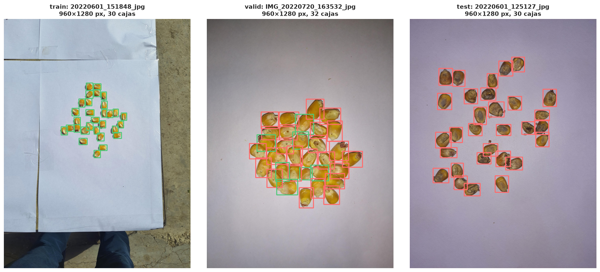

# Informe 1.3: Estructuración del Conjunto de Datos

| | | | |
| :--- | :--- | :--- | :--- |
| **Proyecto:** | Detección de defectos en granos de maíz con YOLOv11 | **Fecha:** | 13 - 10 - 2026 |
| **Objetivo:** | Objetivo Específico 1, Actividad 1.3 | **Notebook:** | `1.3_estructuracion_dataset.ipynb` |
| **Resultado:** | `datos/Data_final` (513 imágenes, 18 712 cajas) | **Figuras:** | `salida/1.3_estructuracion/` |

---

## 1. Planteamiento

Según el PIIC, esta actividad aplica de forma definitiva las técnicas de ingeniería validadas en la Actividad 1.2 y formatea la información:
- partición final de las imágenes y sus etiquetas en entrenamiento, validación y prueba;
- organización de las carpetas en la jerarquía que exige YOLO, con Python y sus librerías de sistema (`os`, `shutil`).

**Entregables:**
- **Pipeline de preprocesamiento en código:** la función `pipeline_dataset_final` de `comun.py`.
- **Dataset final estructurado:** `datos/Data_final`, listo para los modelos del OE2.

## 2. Configuración aplicada

| Transformación | Aplicación en el dataset final |
| :--- | :--- |
| Limpieza de etiquetas | Etiquetas corregidas de `Data_corr_v6` (informe 1.2, limpieza) |
| Consolidación a 2 clases | `Healthy` + `Immature` → **Healthy**; `Broken`, `Damage`, `Fungus`, `Shriveled`, `Weeveled` → **Defect**; sin impurezas ni otras semillas |
| Estandarización geométrica | Letterbox a **1280 px** (lado mayor), relleno gris (114, 114, 114) hasta múltiplo de 32 |
| Normalización fotométrica | **No** (`base`) |
| Balanceo de clases | **No** |
| Normalización de píxeles a [0, 1] | En el dataloader de Ultralytics, al entrenar |
| Aumento de datos | En línea, por defecto de Ultralytics, al entrenar |

La resolución, la normalización fotométrica y el balanceo salen del experimento de la Actividad 1.2 (`resultados/decision.json`). La resolución de 1280 px es una desviación declarada de la regla de decisión (informe 1.2, sección 9.4).

## 3. Pipeline de preprocesamiento



`pipeline_dataset_final` ejecuta todos los pasos a partir de las etiquetas corregidas. La configuración se lee de `decision.json`: si se eligiera el balanceo, el pipeline también lo aplicaría al entrenamiento. Los archivos del dataset final son idénticos byte a byte a los usados en el experimento de la Actividad 1.2.

## 4. Partición final

Se conserva la partición por lote de captura de la Actividad 1.2, sin fuga entre conjuntos:
- **Prueba:** el test fijo, que no se usó en ninguna decisión.
- **Validación:** uno de los 4 pliegues de la validación cruzada.
- **Entrenamiento:** los otros 3 pliegues.

**Elección del pliegue de validación.** Entre los pliegues que tienen entre el 15 y el 25 % de las imágenes, se elige el de composición por subtipo más parecida a la del conjunto de desarrollo. El criterio solo usa etiquetas, no resultados de entrenamiento.

| Pliegue | Imágenes | % del total | Diferencia máxima por subtipo (puntos porcentuales) |
| :---: | :---: | :---: | :---: |
| 0 | 148 | 28.8 | 4.25 (fuera del rango de tamaño) |
| 1 | 101 | 19.7 | 8.57 |
| **2** | **98** | **19.1** | **3.10** |
| 3 | 96 | 18.7 | 8.00 |

| Split | Imágenes | % | Lotes | Cajas | Healthy | Defect | % Healthy |
| :--- | :---: | :---: | :---: | :---: | :---: | :---: | :---: |
| Entrenamiento (`train`) | 345 | 67.3 | 17 | 12 759 | 5 963 | 6 796 | 46.7 |
| Validación (`valid`) | 98 | 19.1 | 5 | 3 486 | 1 656 | 1 830 | 47.5 |
| Prueba (`test`) | 70 | 13.6 | 3 | 2 467 | 1 131 | 1 336 | 45.8 |
| **Total** | **513** | **100** | **25** | **18 712** | **8 750** | **9 962** | **46.8** |

Las dos clases están cerca del equilibrio en los tres splits, y todos los subtipos están presentes en cada uno.



## 5. Estructura del dataset

```
Data_final/
├── data.yaml
├── train/
│   ├── images/           345 imágenes (.jpg)
│   ├── labels/           345 etiquetas YOLO (clase binaria)
│   └── labels_subtipo/   345 etiquetas con el subtipo original
├── valid/                 98 imágenes, con las mismas tres carpetas
└── test/                  70 imágenes, con las mismas tres carpetas
```

```yaml
train: train/images
val: valid/images
test: test/images
nc: 2
names: ["Healthy", "Defect"]
```

- **`labels/`:** una línea por grano, `clase cx cy ancho alto`, con coordenadas normalizadas entre 0 y 1; clase 0 = `Healthy` y 1 = `Defect`.
- **`labels_subtipo/`:** las mismas cajas, en el mismo orden, con el subtipo original (`Broken`, `Fungus`, etc.). YOLO no la lee; sirve para medir el acierto por subtipo en el OE2.
- **`data.yaml`:** usa rutas relativas a su propia carpeta, así que el dataset funciona en cualquier equipo sin editarlo.

## 6. Verificaciones

| Verificación | Resultado | Detalle |
| :--- | :---: | :--- |
| Imágenes por split según la partición | OK | train 345, valid 98, test 70 |
| Cada imagen tiene su etiqueta y su etiqueta de subtipo, y viceversa | OK | |
| Ninguna imagen en dos splits | OK | 513 imágenes únicas |
| Ningún lote de captura en dos splits (sin fuga) | OK | train 17 lotes, valid 5, test 3 |
| Formato YOLO: 5 valores, clase 0 o 1, coordenadas normalizadas | OK | 18 712 cajas, 0 con error |
| Lado mayor de 1280 px y ambos lados múltiplos de 32 | OK | 960 × 1280 (468), 1280 × 960 (35), 1280 × 864 (7), 864 × 1280 (3) |
| Archivos idénticos a los del experimento de la Actividad 1.2 | OK | |
| `data.yaml` válido para Ultralytics | OK | 2 clases: `Healthy`, `Defect` |



## 7. Uso en el OE2

- **Paquete:** `nube/oe1_dataset_final.zip` (154 MB) contiene `Data_final` completo. A 1280 px con lote 8, el entrenamiento necesita unos 12 GB de VRAM, más que la GPU local (6 GB), así que se ejecuta en la nube.
- **Entrenamiento:** `model.train(data='Data_final/data.yaml', imgsz=1280, ...)`.
- **Uso de los splits:** el ajuste de hiperparámetros del OE2 se evalúa en `valid`. El `test` se reserva para la evaluación comparativa final de YOLOv11n y YOLOv11s.
