# Informe 2.1: Configuración del Entorno y Diseño Experimental

| | | | |
| :--- | :--- | :--- | :--- |
| **Proyecto:** | Detección de defectos en granos de maíz con YOLOv11 | **Fecha:** | 13 - 10 - 2026 |
| **Objetivo:** | Objetivo Específico 2, Actividad 2.1 | **Notebooks:** | `2.1_entorno_arquitecturas.ipynb`, `2.1_hiperparametros.ipynb`, `2.1_aumento_datos.ipynb` |
| **Datos:** | `datos/Data_final` (1280 px; train 345, valid 98, test 70) | **Figuras:** | `salida/2.1_entorno/`, `salida/2.1_hiperparametros/`, `salida/2.1_aumento/` |

---

## 1. Planteamiento

La actividad establece el protocolo técnico previo al entrenamiento de YOLOv11n y YOLOv11s:
1. el entorno de ejecución, local y en la nube;
2. la carga de las arquitecturas preentrenadas y la transferencia de aprendizaje;
3. el análisis de todos los hiperparámetros, para decidir con evidencia cuáles se ajustan, cuáles se mantienen y cuáles se desactivan;
4. el diseño experimental de la Actividad 2.2 (`plan_oe2.md`), fijado antes de entrenar.

Ningún notebook de esta actividad entrena modelos.

## 2. Entorno de ejecución

| Componente | Local | Google Colab |
| :--- | :--- | :--- |
| CPU | Intel Core i7-11800H (16 hilos) | Intel Xeon @ 2.20 GHz (12 hilos) |
| RAM | 16 GB | 90 GB |
| GPU | NVIDIA GeForce RTX 3060 Laptop (6 GB) | NVIDIA A100-SXM4 (40 GB) |
| Python | 3.14.8 | 3.13.15 |
| PyTorch | 2.14.1 (CUDA 13.2) | 2.11.0 (CUDA 13.0) |
| **Ultralytics** | **8.4.174** | **8.4.174** |
| **Albumentations** | **2.0.8** | **2.0.8** |
| OpenCV | 5.0.0 | 4.14.0 |
| NumPy | 2.5.3 | 2.1.3 |

Ultralytics y Albumentations, que definen el entrenamiento, el aumento y las métricas, se fijan a la misma versión en las dos plataformas. Python, PyTorch, OpenCV y NumPy son los de cada plataforma.

Cada equipo registra su hardware y sus versiones en `resultados/entorno_<plataforma>.json` (`comun_oe2.registrar_entorno`). El de Colab se registró al comenzar el entrenamiento de la 2.2 en la A100.

## 3. Arquitecturas y transferencia de aprendizaje

| Modelo | Parámetros | GFLOPs a 640 px | GFLOPs a 1280 px | Tensores transferidos de COCO |
| :--- | :---: | :---: | :---: | :---: |
| YOLOv11n | 2.59 M | 6.5 | 26.7 | 448 / 499 |
| YOLOv11s | 9.43 M | 21.7 | 88.1 | 493 / 499 |

Cada modelo se construye para 2 clases (`Healthy`, `Defect`) y recibe los pesos preentrenados en COCO (80 clases):
- **Se heredan completos:** el backbone, el cuello y la rama de regresión de cajas.
- **Se reinicia:** solo la rama de clasificación de la cabeza (`model.23.cv3`), porque su ancho depende del número de clases. En YOLOv11n se reinician más tensores que en YOLOv11s porque esa rama es más estrecha y cambia de forma con 2 clases.

YOLOv11s tiene 3.6 veces más parámetros y 3.3 veces más operaciones que YOLOv11n. A 1280 px, las operaciones se multiplican por 4 respecto a 640 px.

## 4. Perfil de memoria y entorno híbrido

Se ejecutaron pasadas de entrenamiento completas (pérdida de YOLO, retropropagación y paso del optimizador, con precisión mixta) con imágenes y etiquetas reales a 1280 × 1280 px, sin guardar pesos.

La pasada simulada no incluye el cargador de datos ni la validación, así que subestima la memoria real. Se calibró con la medición real del OE1: YOLOv11s con lote 8 usó 11.6 GB de media en la A100, frente a 8.6 GB estimados, un factor de 1.34.

| Lote | YOLOv11n | YOLOv11s |
| :---: | :---: | :---: |
| 4 | 3.4 GB | 6.0 GB |
| 8 | 6.7 GB | 11.6 GB |
| 16 | 13.2 GB (extrapolada) | 22.7 GB (extrapolada) |

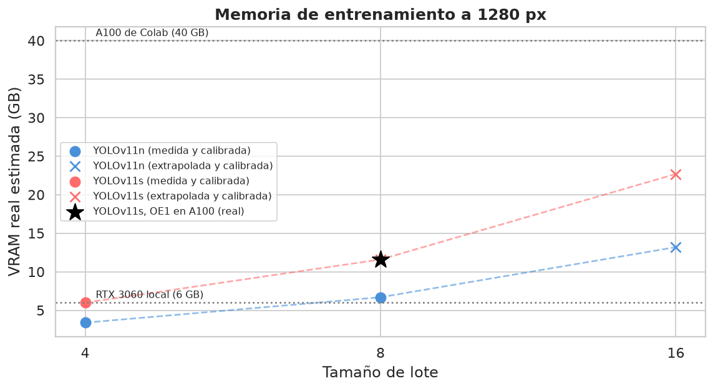

**Conclusiones:**
- La GPU local (6 GB) solo admitiría YOLOv11n con lote 4 a 1280 px. **El entrenamiento se hace en la A100 de Colab.**
- **El lote 32 se descarta:** con lote 16, YOLOv11s ya necesita unos 23 GB, y el doble superaría los 40 GB de la A100.

**Reparto del entorno híbrido:**

| Tarea | Dónde |
| :--- | :--- |
| Preparación de datos, análisis, figuras y este perfil | RTX 3060 local |
| Entrenamiento a 1280 px (Actividad 2.2) | A100 de Colab, la misma GPU para todas las corridas |
| Validación e inferencia con los modelos entrenados | RTX 3060 local |
| Tiempo de inferencia (FPS, Actividad 2.3) | RTX 3060 local y CPU, el hardware de uso previsto |

## 5. Análisis de los hiperparámetros

Se revisaron los 85 parámetros de entrenamiento, validación e hiperparámetros de `default.yaml` (Ultralytics 8.4.174), más `augmentations`, que solo existe en la API de Python. El análisis se organiza por grupos, cada uno con su evidencia; una comprobación final del notebook garantiza que ninguno queda sin revisar.

| Grupo | Parámetros | Se ajustan en la 2.2 | Se desactivan |
| :--- | :---: | :--- | :--- |
| Optimización | 13 | `optimizer`, `lr0` | — |
| Aumento: color | 4 | — | `bgr` |
| Aumento: geometría | 7 | `flipud` (con `RandomRotate90`) | `degrees`, `shear`, `perspective` |
| Aumento: composición de imágenes | 6 | — | `mixup`, `cutmix` |
| Aumento: Albumentations | 1 | `augmentations` | — |
| Pérdida y clases | 4 | — | `cls_pw` |
| Validación y NMS | 5 | — | — |
| Modelo y transferencia | 9 | — | `freeze` (se afinan todas las capas), `multi_scale` (más memoria; `scale` ya varía el tamaño del grano) |
| Configuración de ejecución | 25 | — | — |
| No aplican (segmentación, pose, OBB, profundidad, clasificación) | 12 | — | — |

Los parámetros que no se ajustan ni se desactivan se mantienen por defecto o quedan fijados por el protocolo: modelos, transferencia desde COCO, 1280 px y épocas. La **configuración de ejecución** (`workers`, `device`, `cache`, `project`, `seed`, `amp`…) no cambia lo que aprende el modelo y se fija igual para todas las corridas.

### 5.1. Optimización

- **Modo `'auto'`:** con 345 imágenes y 100 épocas hay 600 iteraciones, menos de 10 000. En ese caso, el modo `'auto'`, que los artículos llaman "valores por defecto", elige **AdamW con lr0 = 0.00167** e ignora el `lr0` configurado. Por eso el optimizador se compara explícitamente en la 2.2, cada uno con su tasa estándar.
- **Lote efectivo:** con `nbs = 64`, el entrenador acumula gradientes hasta 64 imágenes con cualquier lote (4 × 16, 8 × 8 o 16 × 4 pasos). El lote cambia sobre todo la velocidad, la memoria y las estadísticas de BatchNorm, así que **no se ajusta**: se usa el valor por defecto de Ultralytics, **16**, que cabe en la A100.
- **Calendario de la tasa de aprendizaje:** se mantiene el por defecto, con calentamiento de 3 épocas y caída lineal hasta el 1 % de `lr0`.

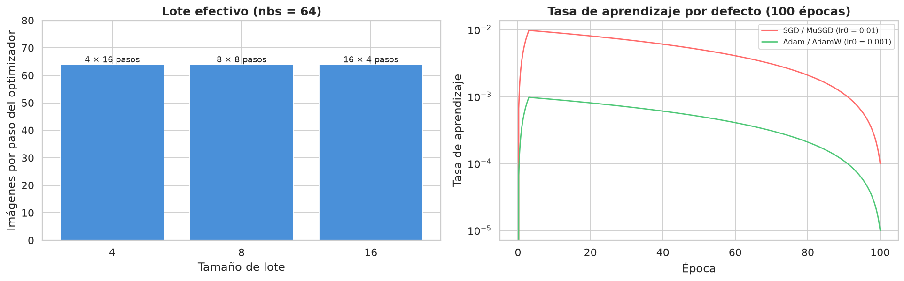

El aumento nativo de Ultralytics (secciones 5.2 a 5.4) se analiza en `2.1_hiperparametros.ipynb`; las transformaciones de Albumentations que se agregan (sección 5.5), en `2.1_aumento_datos.ipynb`.

### 5.2. Color: `bgr` se desactiva, el HSV por defecto se mantiene

En este dataset el color es una señal diagnóstica (`Fungus`, `Damage`, `Shriveled`).
- **`bgr`** intercambia los canales rojo y azul y lleva el grano de los tonos amarillos y naranjas a tonos azules, que no existen en el maíz.
- **El aumento HSV por defecto** escala el tono solo un ±1.5 % (su distribución prácticamente no cambia) y varía la saturación y el brillo como lo hacen distintas cámaras e iluminaciones.

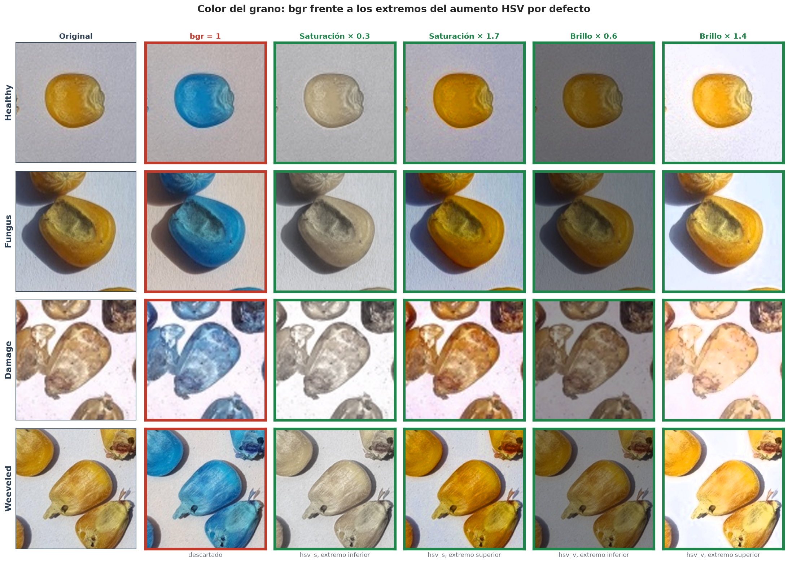

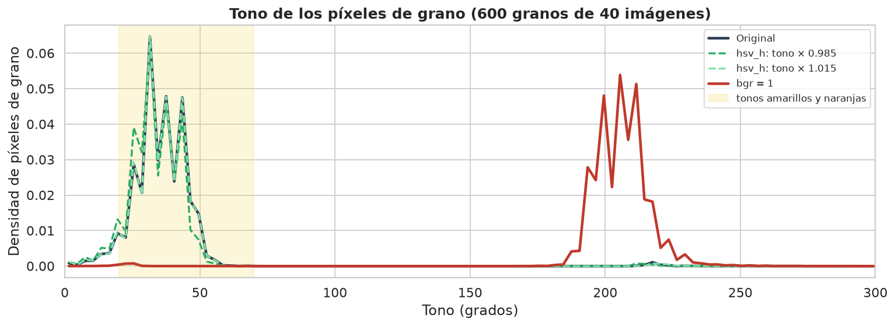

### 5.3. Geometría: giros y cizalla se desactivan; volteo vertical y giros de 90° se prueban

Al girar o cizallar la imagen, Ultralytics toma el rectángulo que contiene las esquinas transformadas de cada caja, y ese rectángulo es mayor que el grano. Se midió el IoU máximo entre esa caja y la caja real del grano transformado, modelado como la elipse inscrita en su caja, en las 12 759 cajas de entrenamiento:

| Transformación | IoU máximo con la caja real (media) |
| :--- | :---: |
| Giro de 10° | 0.74 |
| Giro de 30° | 0.54 |
| Giro de 45° | 0.50 |
| Cizalla de 5° | 0.92 |
| Cizalla de 10° | 0.86 |
| **Volteo vertical** | **1.00** |
| **Giro de 90°** | **1.00** |

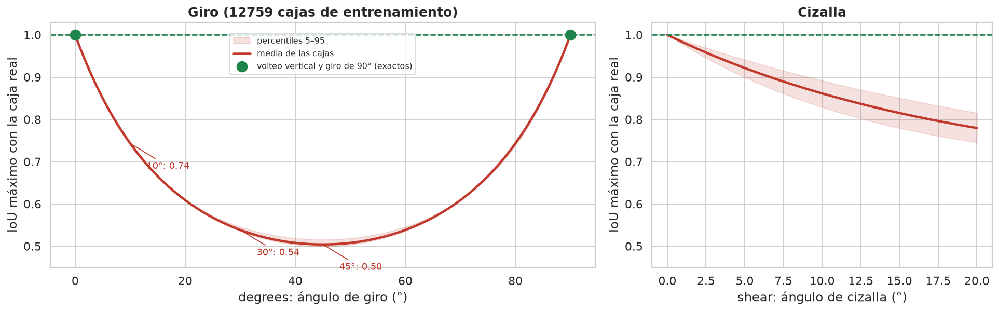

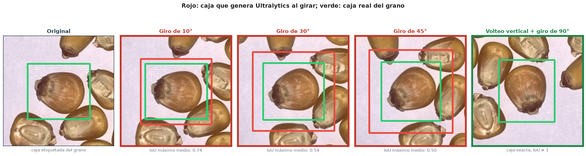

- **Giros y cizalla:** un giro de solo 10° ya baja el IoU máximo a 0.74. Entrenar con esas cajas enseñaría a predecir cajas holgadas, lo que penaliza el mAP50-95.
- **Volteo vertical y giros de 90°:** conservan el ajuste exacto y, en una vista cenital, el grano no tiene orientación preferente. Se prueban en la 2.2 dentro de la configuración de aumento C; por defecto no están activos (`flipud = 0.0`, `degrees = 0.0`).
- **Escala:** el aumento de escala por defecto (`scale = 0.5`) se mantiene. Reescala cada imagen entre ×0.5 y ×1.5, como fotos tomadas más lejos o más cerca. El lado menor mediano del grano, de 48 px, pasa a variar entre unos 24 y 72 px.

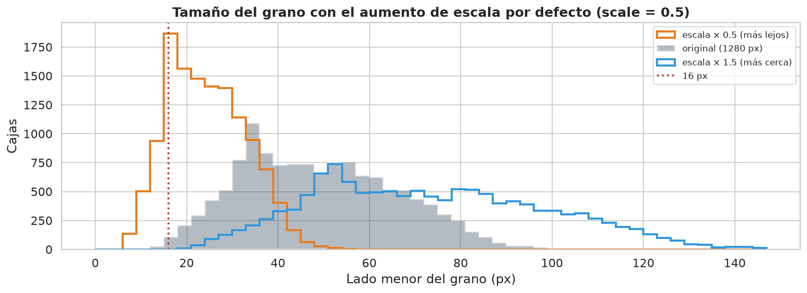

### 5.4. Composición de imágenes: el mosaico se mantiene; `mixup` y `cutmix` se desactivan

El aumento por defecto, con mosaico, escala, HSV y volteo horizontal, combina imágenes sin superponerlas: cada grano conserva su apariencia y su etiqueta.

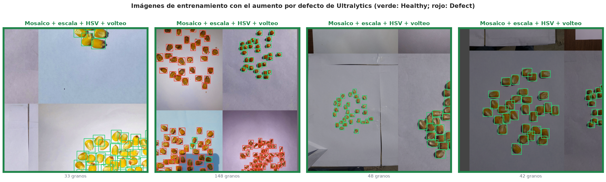

- **`mixup`** superpone dos imágenes al ~50 % y produce granos semitransparentes con dos etiquetas: los defectos superficiales quedan a medias.
- **`cutmix`** conserva granos de los que solo queda visible el 10 % de su caja. En el ejemplo, 3 granos con menos de la mitad visible siguen etiquetados. Si el defecto quedó fuera del recorte, la etiqueta no corresponde a lo visible: es la contradicción entre etiqueta y apariencia que se corrigió en la limpieza del OE1.

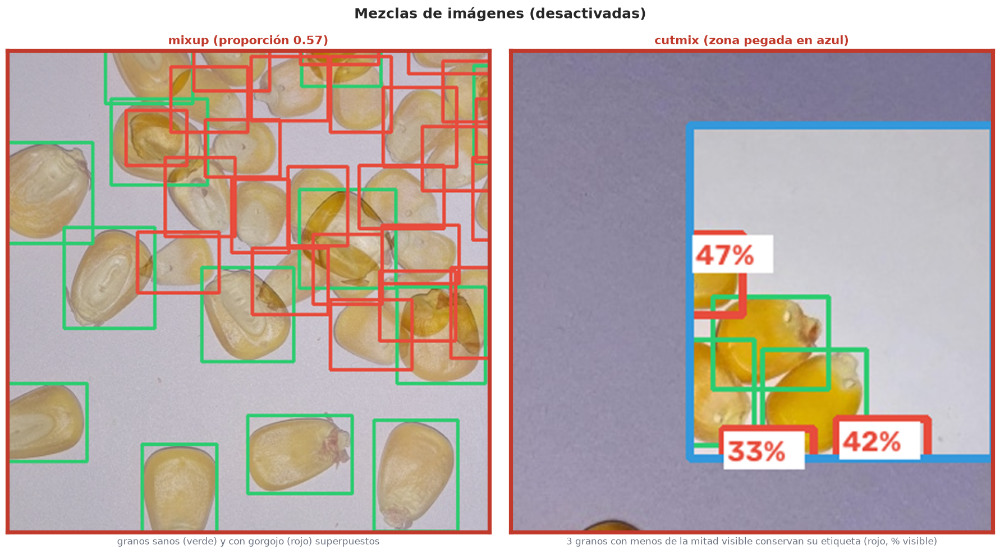

### 5.5. Albumentations: el conjunto propio reemplaza al de Ultralytics

Con Albumentations instalado, Ultralytics aplica por defecto `Blur`, `MedianBlur`, `ToGray` y `CLAHE`, cada una con p = 0.01. La lista de `augmentations` las reemplaza.

| Transformación por defecto | Decisión |
| :--- | :--- |
| `ToGray` | Se descarta: elimina el color |
| `CLAHE` | Se descarta: oscurece el grano y altera su color y su contraste, y puede crear manchas que parecen defectos |
| `Blur`, `MedianBlur` | No se incluyen: son de la misma familia que `Defocus`, que simula el desenfoque de la lente; el orificio de gorgojo sigue visible con ambas |

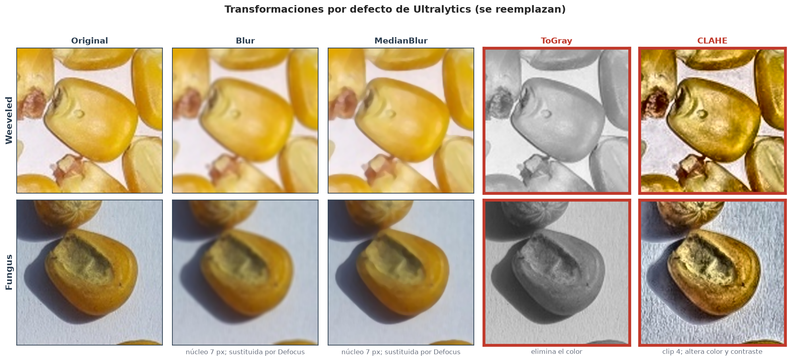

El conjunto propio es fotométrico y no deforma la imagen. Sus transformaciones se agrupan por familia para que no se acumulen dos del mismo tipo en una imagen: dentro de un `OneOf` se aplica como máximo una.

| Familia | Transformaciones | p |
| :--- | :--- | :---: |
| Brillo y contraste | Una de `RandomGamma` (gamma 75 a 125) o `RandomToneCurve` (scale 0.25), además de `hsv_v` de Ultralytics | 0.35 |
| Nitidez | Una de `Sharpen` (alpha 0.25 a 0.40) o `Defocus` (radio 2 a 4) | 0.40 |
| Ruido del sensor | `GaussNoise` (std 0.06 a 0.12) | 0.20 |
| Compresión JPEG | `ImageCompression` (calidad 80 a 95) | 0.15 |

- **Brillo y contraste:** las tres transformaciones cambian la luminancia de forma distinta. `hsv_v` multiplica el brillo de forma lineal y, al aclarar, satura los tonos claros. `RandomGamma` curva los tonos medios y mantiene fijos el negro y el blanco. `RandomToneCurve` aplica una curva tonal aleatoria. El `OneOf` evita acumular dos cambios de brillo en la misma imagen.
- **Nitidez:** `Sharpen` y `Defocus` son opuestas, así que nunca se aplican juntas. `Blur` y `MedianBlur` no se incluyen: son de la misma familia que `Defocus`, que es la que simula el desenfoque de la lente.
- **Ruido y compresión:** van por separado, porque en una cámara real ocurren juntos.

El conjunto conserva el color del grano, las manchas de hongo y el orificio de gorgojo. En su parámetro máximo, `GaussNoise` y `Defocus` son notorios; por eso se aplican con probabilidades bajas y con rangos que empiezan más suaves.

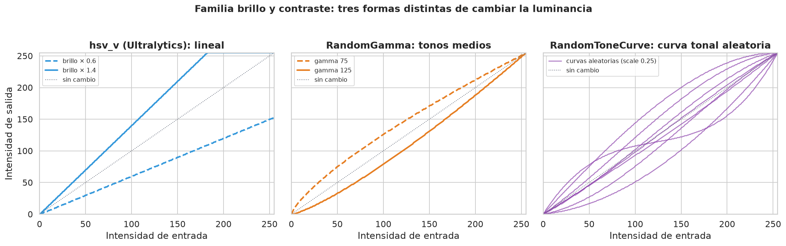

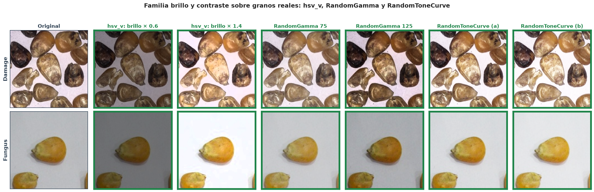

**Combinación de aumentos.** Ultralytics aplica los aumentos en cadena sobre cada imagen:
1. mosaico;
2. escala y traslación;
3. Albumentations;
4. HSV;
5. volteo vertical;
6. volteo horizontal.

Cada transformación decide por su cuenta, con su probabilidad, si se aplica. Por eso la geometría y la fotometría se combinan en la misma imagen. Los `OneOf` solo impiden que coincidan dos transformaciones de la misma familia; entre familias, la combinación es libre y multiplica la variabilidad.

La configuración de aumento C de la 2.2 es la combinación completa: el aumento por defecto, el conjunto propio, el volteo vertical (`flipud = 0.5`) y `RandomRotate90` (p = 0.5). Las imágenes siguientes salen del flujo real de Ultralytics con esa configuración.

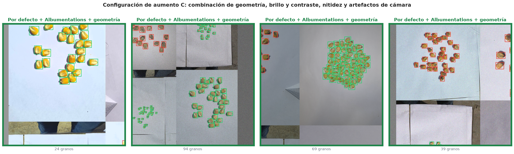

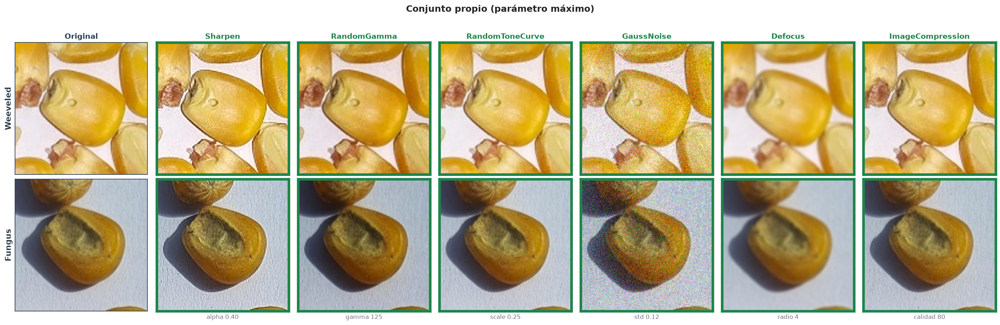

### 5.6. Pérdida, clases y validación

- **`cls_pw`:** con 5 963 cajas `Healthy` y 6 796 `Defect` en entrenamiento, incluso el peso completo (`cls_pw = 1`) deja pesos de 1.07 y 0.93. No aporta; el balanceo tampoco tuvo efecto en el OE1.
- **Pesos de la pérdida (`box` = 7.5, `cls` = 0.5, `dfl` = 1.5):** se mantienen por defecto. Son valores equilibrados entre la regresión de la caja, la clasificación y la distribución de los bordes; alterarlos cambia ese equilibrio y podría afectar a los resultados. Si el modelo se comporta mal en la detección o en la clasificación, pueden ajustarse en el futuro.
- **`max_det`:** el máximo es de 98 granos por imagen, muy por debajo del límite de 300 detecciones.

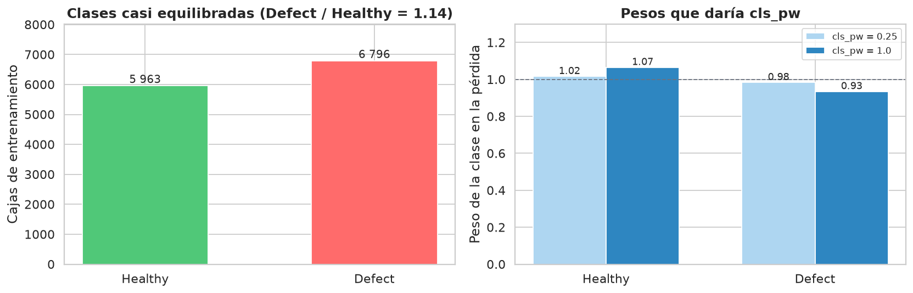

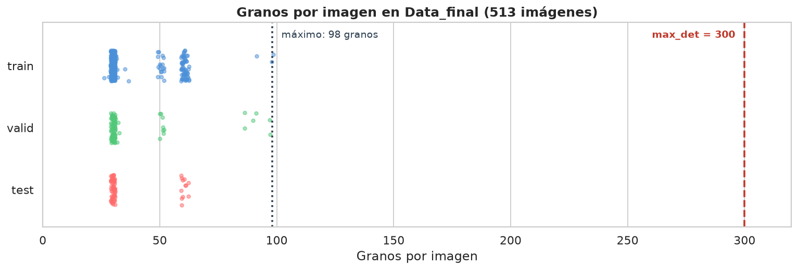

## 6. Diseño experimental de la Actividad 2.2

El diseño completo está en `plan_oe2.md`:
- **Factores:**
  - optimizador: SGD, MuSGD, Adam y AdamW, cada uno con su tasa estándar;
  - tasa de aprendizaje: ×0.5 y ×2 de la estándar del optimizador elegido;
  - aumento, con tres configuraciones: A, la por defecto; B, A más el conjunto propio de Albumentations; C, B más el volteo vertical y los giros de 90°.
- **Épocas:** 100 en el ajuste; 200 con `patience = 50` en el entrenamiento final.
- **Procedimiento:**
  - cribado en `train` / `valid`, con 3 semillas por configuración, en el que se adoptan las mejoras de al menos +0.005 de mAP50-95 medio;
  - tamaño de lote: el por defecto de Ultralytics, 16;
  - confirmación con la validación cruzada de 4 pliegues del OE1;
  - entrenamiento final con 3 semillas.
- **Corridas:** de 54 a 86, todas en la A100.

**Transferencia de aprendizaje:** todos los modelos parten de los pesos de COCO y se afinan **todas** las capas. No se entrena desde cero, porque el dataset es pequeño (345 imágenes de entrenamiento), ni se congela el backbone, porque los granos de maíz están lejos de las clases de COCO y sus características deben adaptarse.
