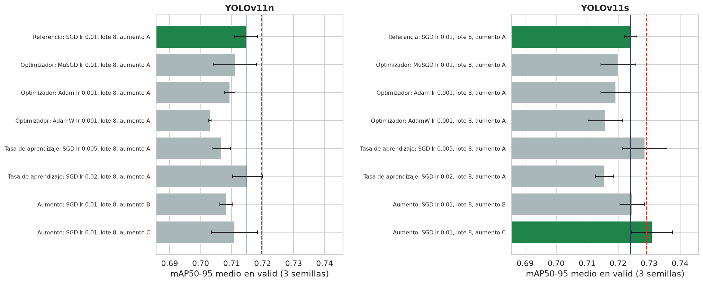
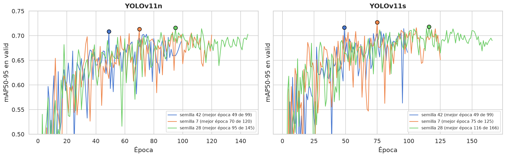

# Informe 2.2: Entrenamiento y Ajuste de Hiperparámetros

| | | | |
| :--- | :--- | :--- | :--- |
| **Proyecto:** | Detección de defectos en granos de maíz con YOLOv11 | **Fecha:** | 15 - 10 - 2026 |
| **Objetivo:** | Objetivo Específico 2, Actividad 2.2 | **Notebook:** | `2.2_entrenamiento.ipynb` |
| **Datos:** | `datos/Data_final` (1280 px; train 345, valid 98, test 70) y la partición por lote del OE1 (`particion.json`) | **Figuras:** | `salida/2.2_entrenamiento/` |
| **Registro:** | `resultados/experimentos/` (un CSV por fase, una fila por corrida) | **Resultado:** | `resultados/configuracion_final.json`, `runs/oe2/*_final/weights/best.pt` |

---

## 1. Planteamiento

La actividad entrena YOLOv11n y YOLOv11s y ajusta empíricamente sus hiperparámetros con el diseño fijado en la Actividad 2.1 (`plan_oe2.md`). Se ajustan tres factores:
- el optimizador: SGD, MuSGD, Adam y AdamW, cada uno con su tasa estándar;
- la tasa de aprendizaje: ×0.5 y ×2 de la estándar;
- el aumento en línea: A, el de Ultralytics por defecto; B, A más el conjunto propio de Albumentations; C, B más volteo vertical y giros de 90°.

El ajuste se hace en tres fases, cada una en una sesión de Google Colab con la A100:

| Fase | Datos | Semillas | Lote | Épocas | Corridas |
| :--- | :--- | :--- | :---: | :--- | :---: |
| **1. Cribado** | `train` / `valid` | 13, 29, 51 | 8 | 100 | 48 |
| **2. Confirmación** | 4 pliegues por lote del OE1 | 13, 29 | 16 | 100 | 16 (solo YOLOv11s) |
| **3. Final** | `train` / `valid` | 42, 7, 28 | 16 | hasta 200 (`patience` = 50) | 6 |

**Protocolo común:**
- 1280 px y transferencia desde COCO, con todas las capas afinadas;
- semilla fija y modo determinista;
- `warmup_bias_lr = 0` con Adam y AdamW, como hace Ultralytics en su modo `'auto'`.

**Lote:** no se ajusta. Se usa el valor por defecto de Ultralytics, 16, en la confirmación y en el entrenamiento final; el cribado se ejecutó con lote 8, el del protocolo del OE1.

**Métrica de decisión:** el mAP50-95 en validación.

**Test:** no se usa en ninguna fase.

## 2. Cribado

Para cada modelo, los factores se prueban en orden: optimizador, tasa de aprendizaje y aumento. Cada uno se prueba sobre la configuración elegida en el paso anterior. Cada configuración se entrena con 3 semillas, y una alternativa se adopta solo si su mAP50-95 medio supera a la configuración base en al menos **+0.005**.

El cribado se ejecutó primero con las semillas 13 y 29, y se amplió a 3 añadiendo la semilla 51 a todas las configuraciones por igual.

| Paso | Configuración | YOLOv11n | YOLOv11s |
| :--- | :--- | :---: | :---: |
| Referencia | SGD, lr 0.01, aumento A | **0.7146** ± 0.0037 | **0.7241** ± 0.0020 |
| Optimizador | MuSGD, lr 0.01 | 0.7111 ± 0.0070 | 0.7201 ± 0.0057 |
| | Adam, lr 0.001 | 0.7094 ± 0.0017 | 0.7193 ± 0.0048 |
| | AdamW, lr 0.001 | 0.7031 ± 0.0004 | 0.7159 ± 0.0055 |
| Tasa de aprendizaje | SGD, lr 0.005 | 0.7068 ± 0.0029 | 0.7286 ± 0.0072 |
| | SGD, lr 0.02 | 0.7152 ± 0.0048 | 0.7157 ± 0.0029 |
| Aumento | B | 0.7082 ± 0.0020 | 0.7246 ± 0.0040 |
| | C | 0.7109 ± 0.0074 | **0.7310** ± 0.0065 |

*mAP50-95 medio en `valid` ± desviación estándar de las 3 semillas. En negrita, la configuración elegida en cada paso.*

**Resultados:**
- **Optimizador:** SGD fue el mejor en los dos modelos. AdamW, el que elige el modo `'auto'` de Ultralytics para un entrenamiento de este tamaño, fue el peor: −0.012 en YOLOv11n y −0.008 en YOLOv11s.
- **Tasa de aprendizaje:**
  - YOLOv11n: lr 0.02 empató con la referencia (+0.0006).
  - YOLOv11s: lr 0.005 quedó a +0.0045, por debajo del umbral, y con la mayor dispersión del paso.

  Se mantiene lr 0.01 en ambos.
- **Aumento:**
  - **YOLOv11n:** ni B ni C mejoraron a la referencia. Su ganadora del cribado es la referencia y no necesita confirmación.
  - **YOLOv11s:** C superó a la referencia en +0.0069 y pasó a la confirmación. B quedó prácticamente igual a la referencia (+0.0005).

## 3. Confirmación (YOLOv11s)

La ganadora del cribado de YOLOv11s (aumento C) se compara con la referencia (aumento A) en los 4 pliegues de la validación cruzada por lote del OE1. Se usan las semillas 13 y 29, lote 16 en ambas y 100 épocas, lo que da 8 comparaciones emparejadas por pliegue y semilla.

C se adopta solo si mejora a A en al menos +0.005 de media y la mejora es significativa (t pareada, p < 0.05).

La confirmación se ejecutó primero con la semilla 13 y se amplió con la 29 para aumentar la potencia de la prueba, sin cambiar la regla.

| Pliegue | Semilla | A (referencia) | C (candidata) | Diferencia |
| :---: | :---: | :---: | :---: | :---: |
| 0 | 13 | 0.7602 | 0.7737 | +0.0135 |
| 0 | 29 | 0.7677 | 0.7703 | +0.0025 |
| 1 | 13 | 0.7249 | 0.7749 | +0.0500 |
| 1 | 29 | 0.7362 | 0.7835 | +0.0473 |
| 2 | 13 | 0.7294 | 0.7226 | −0.0068 |
| 2 | 29 | 0.7120 | 0.7147 | +0.0027 |
| 3 | 13 | 0.7729 | 0.7618 | −0.0111 |
| 3 | 29 | 0.7622 | 0.7629 | +0.0007 |
| **Media** | | | | **+0.0123** (p = 0.18) |

**Decisión: no se confirma; YOLOv11s se queda con el aumento A.**
- La diferencia media supera el umbral (+0.0123 ≥ +0.005), y C gana en 6 de las 8 comparaciones.
- Pero la mejora no es significativa (p = 0.18). Casi toda procede del pliegue 1 (+0.050 y +0.047 en las dos semillas).
- En los pliegues 2 y 3, C empata o pierde ligeramente.

El efecto de C depende de la composición del pliegue y no es una mejora general. Por subtipo, la media de las 8 corridas muestra el mismo patrón:

| Acierto por subtipo | A | C |
| :--- | :---: | :---: |
| `Fungus` | 0.942 | **0.979** (pliegue 1: 0.821 → 0.980) |
| `Weeveled` | 0.851 | 0.863 |
| `Immature` | **0.826** | 0.720 |
| `Healthy` | **0.937** | 0.912 |
| MAE de conteo (granos por imagen) | 0.345 | 0.322 |

*Acierto: el grano se detecta (IoU ≥ 0.5) con la clase binaria correcta, a confianza 0.25 y con NMS agnóstico.*

C mejora la clasificación de `Fungus`, pero empeora la de `Immature` y `Healthy`. El aumento C queda documentado como candidato para la validación con imágenes externas (`plan_oe2.md`). Ahí la variación de cámara e iluminación es mayor que en el dataset de laboratorio.

## 4. Entrenamiento final

**Configuración adoptada para los dos modelos:**
- SGD con `lr0 = 0.01`;
- lote 16;
- aumento A, el de Ultralytics por defecto.

Cada modelo se entrena con 3 semillas, hasta 200 épocas y con `patience = 50`. Ultralytics guarda como `best.pt` la época con el mejor mAP50-95 en `valid`.

### 4.1. Métricas en validación

| Métrica | YOLOv11n | YOLOv11s |
| :--- | :---: | :---: |
| mAP50-95 | 0.7128 ± 0.0037 | **0.7207** ± 0.0055 |
| mAP50 | 0.9603 ± 0.0074 | 0.9580 ± 0.0051 |
| mAP75 | 0.8437 ± 0.0170 | 0.8556 ± 0.0080 |
| Precisión | 0.8629 ± 0.0222 | 0.8853 ± 0.0082 |
| Recall | 0.9210 ± 0.0090 | 0.9103 ± 0.0115 |
| AP50-95 `Healthy` | 0.7047 ± 0.0026 | 0.7321 ± 0.0142 |
| AP50-95 `Defect` | 0.7209 ± 0.0073 | 0.7092 ± 0.0250 |
| F1 máximo | 0.8875 ± 0.0100 | 0.8955 ± 0.0079 |
| Umbral de confianza de máximo F1 | 0.398 ± 0.042 | 0.454 ± 0.017 |
| MAE de conteo (granos por imagen) | 0.476 ± 0.021 | 0.398 ± 0.138 |

*Media ± desviación estándar de las 3 semillas, en `valid` (98 imágenes, 3 486 granos). El MAE de conteo y el acierto por subtipo se calculan al umbral de máximo F1 de cada corrida, con NMS agnóstico a la clase.*

| Acierto por subtipo | Broken | Damage | Fungus | Healthy | Immature | Shriveled | Weeveled |
| :--- | :---: | :---: | :---: | :---: | :---: | :---: | :---: |
| YOLOv11n | 0.927 | 0.931 | 0.980 | 0.840 | 0.753 | 0.968 | 0.892 |
| YOLOv11s | 0.843 | 0.847 | 0.967 | 0.897 | 0.838 | 0.918 | 0.867 |

**Lectura:**
- **Detección:**
  - YOLOv11s supera a YOLOv11n en +0.008 de mAP50-95 medio. Es una diferencia pequeña frente a la variación entre semillas, cuya desviación es de 0.004 a 0.006.
  - Con IoU 0.5 los dos modelos son equivalentes (mAP50 ≈ 0.96). La ventaja de YOLOv11s está en la precisión de la caja (mAP75 +0.012).
- **Clasificación:** los dos modelos reparten los errores de forma distinta.
  - YOLOv11s es más preciso y clasifica mejor `Healthy` e `Immature`.
  - YOLOv11n tiene más recall y acierta más en `Broken`, `Damage`, `Shriveled` y `Weeveled`.
  - El umbral de máximo F1 de YOLOv11n es menor (0.40 frente a 0.45), coherente con su mayor recall.
- **Conteo:** con NMS agnóstico, el error medio es de 0.40 a 0.48 granos por imagen, un 1.1 % a 1.3 % de los 35.6 granos medios por imagen de `valid`.
- **Coherencia con el cribado:** los valores finales están dentro de la variación entre semillas de la referencia del cribado (0.7146 en YOLOv11n y 0.7241 en YOLOv11s). Entrenar hasta 200 épocas con lote 16 no cambia el rendimiento respecto a 100 épocas con lote 8.

**Estas métricas no son una estimación del rendimiento final.** `valid` se usó para elegir la época de `best.pt` y el umbral de confianza, así que sus valores son optimistas.

### 4.2. Convergencia

| Modelo | Semilla 42 | Semilla 7 | Semilla 28 |
| :--- | :---: | :---: | :---: |
| YOLOv11n | 49 de 99 | 70 de 120 | 95 de 145 |
| YOLOv11s | 49 de 99 | 75 de 125 | 116 de 166 |

*Mejor época de cada corrida, de las épocas ejecutadas.*

- Ninguna corrida llegó a las 200 épocas. Todas se detuvieron 50 épocas después de su mejor época, así que el límite de 200 fue suficiente.
- Las curvas alcanzan una meseta en torno a 0.70 hacia la época 60 a 70. Después oscilan en un margen de ±0.02 sin tendencia, y la época de `best.pt` depende de la semilla (49 a 116).
- **El calendario de entrenamiento depende de `epochs`:**
  - la tasa de aprendizaje decae linealmente de `lr0` a `lr0 · lrf` (0.0001) en la época 200;
  - el mosaico se desactiva en las 10 últimas (`close_mosaic = 10`), desde la época 190.

  Como las corridas se detuvieron entre las épocas 99 y 166, el entrenamiento final no llegó a esas etapas. Las corridas de ajuste, a 100 épocas, sí las completaron. Aun así, los dos protocolos dan el mismo rendimiento (sección 4.1).

### 4.3. Umbral de confianza para el conteo

El umbral de cada modelo es la mediana de los umbrales de máximo F1 de sus 3 semillas:
- **YOLOv11n:** 0.397;
- **YOLOv11s:** 0.457.

Los dos umbrales se aplican con NMS agnóstico a la clase, para que cada grano reciba una sola caja. Quedan registrados en `resultados/configuracion_final.json` junto con la configuración y las rutas de los 3 `best.pt` de cada modelo.

## 5. Costo computacional

Todas las corridas se ejecutaron en la misma GPU, la NVIDIA A100-SXM4-40GB de Colab.

| Fase | Corridas | Horas de GPU |
| :--- | :---: | :---: |
| Cribado | 48 | 8.6 |
| Confirmación | 16 | 3.0 |
| Final | 6 | 1.0 |
| **Total** | **70** | **12.6** |

| VRAM media | Lote 8 | Lote 16 |
| :--- | :---: | :---: |
| YOLOv11n | 9.0 GB | 18.6 GB |
| YOLOv11s | 12.0 GB | 24.5 GB |

*Medida en las corridas de la 2.2. Incluye el cargador de datos y la validación.*

- Para YOLOv11s, la estimación calibrada de la Actividad 2.1 (11.6 y 22.7 GB) acertó con un error de menos del 8 %.
- Para YOLOv11n, la estimación subestimó la memoria real. El factor de calibración se obtuvo con YOLOv11s, y en el modelo pequeño el cargador de datos y la validación pesan proporcionalmente más.
- En los dos modelos, la memoria real cabe en la A100 con margen. Ninguna configuración entrenada cabría en la GPU local (6 GB).

## 6. Conclusiones

1. **La configuración final de los dos modelos es la de Ultralytics por defecto:** SGD con `lr0 = 0.01`, lote 16 y el aumento por defecto, a 1280 px.
   - Ninguna alternativa del cribado superó a la referencia en YOLOv11n.
   - En YOLOv11s, el aumento C no se confirmó en la validación cruzada.
2. **El ajuste aporta evidencia para mantener los valores por defecto:**
   - Los optimizadores adaptativos, incluido AdamW, el que elegiría el modo `'auto'`, fueron peores que SGD en los dos modelos.
   - La tasa de aprendizaje estándar no se mejoró.
   - Las mejoras del aumento propio dependen del pliegue.
3. **El aumento C queda como candidato para la validación con imágenes externas.** Mejora la clasificación de `Fungus` y el pliegue con más defectos difíciles, pero no de forma general en el dataset de laboratorio.
4. **YOLOv11s supera ligeramente a YOLOv11n en validación** (+0.008 de mAP50-95), con un error de conteo de menos de medio grano por imagen en ambos. La comparación definitiva se hace con el test, que en esta actividad no se usó.
