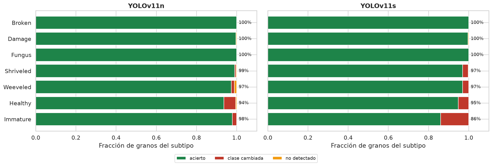
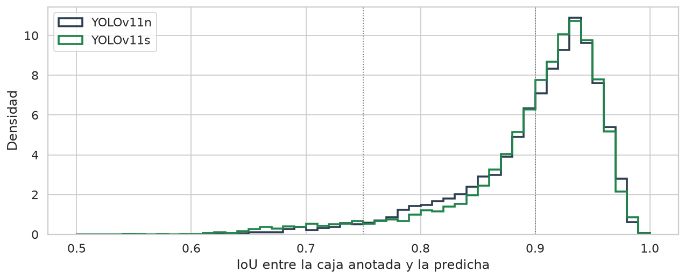
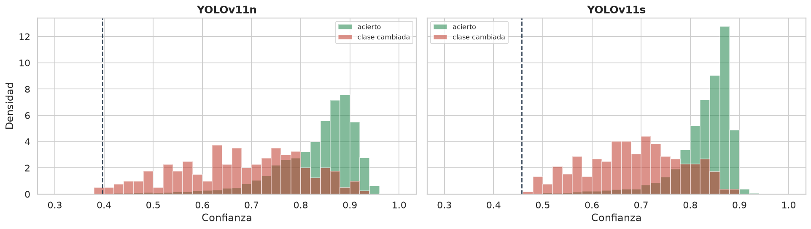
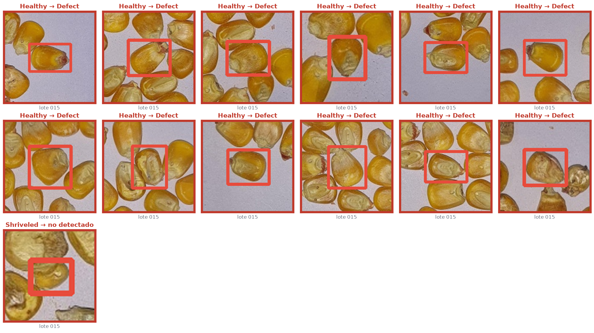
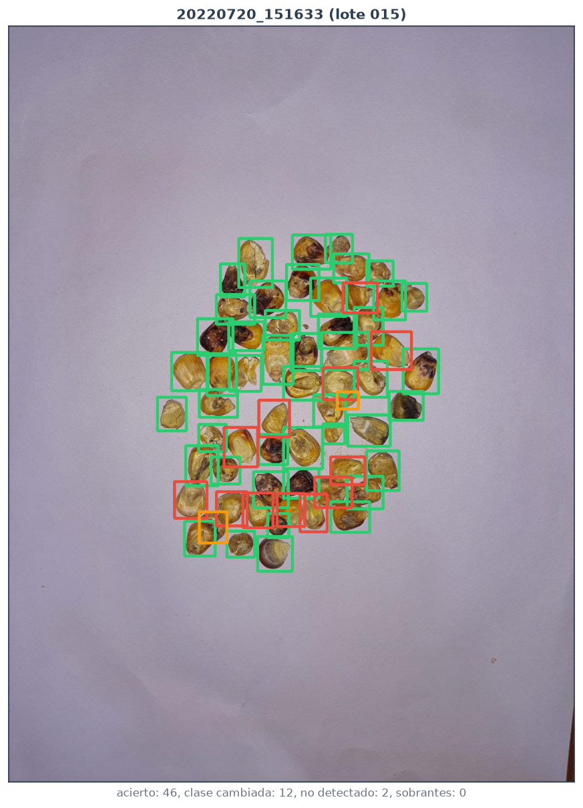
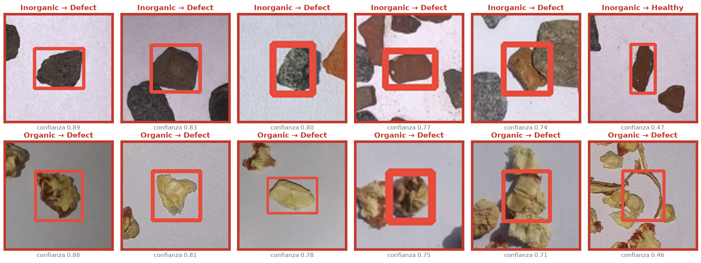
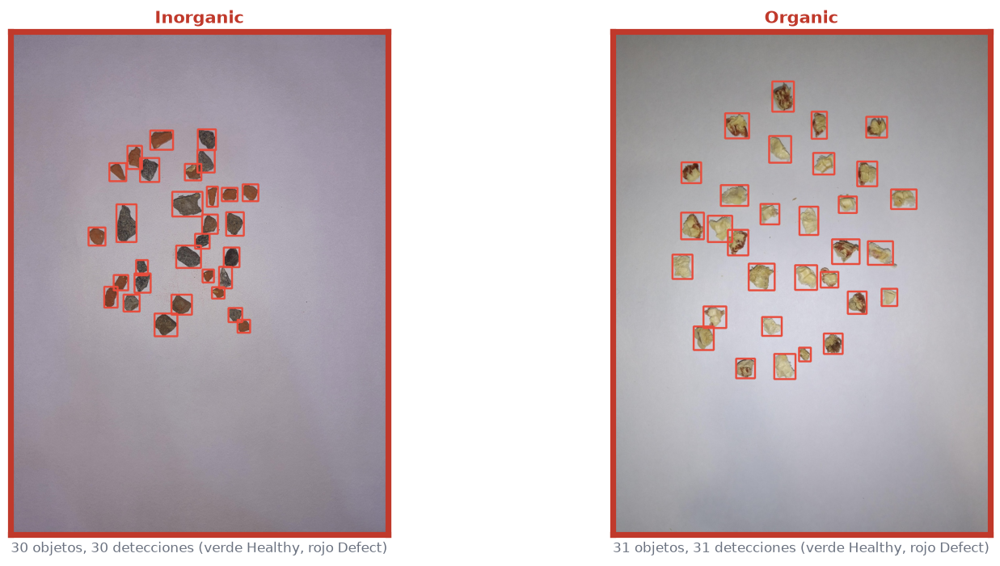
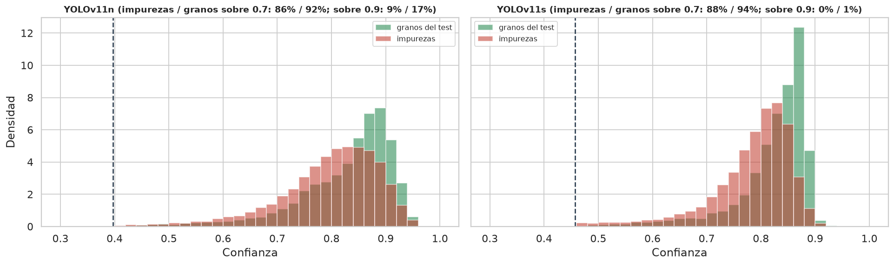

# Diagnóstico de los Modelos Finales en el Test

| | | | |
| :--- | :--- | :--- | :--- |
| **Proyecto:** | Detección de defectos en granos de maíz con YOLOv11 | **Fecha:** | 15 - 10 - 2026 |
| **Objetivo:** | Objetivo Específico 2, diagnóstico previo a la Actividad 2.3 | **Notebook:** | `2.2b_diagnostico_test.ipynb` |
| **Modelos:** | `configuracion_final.json` de la 2.2: YOLOv11n y YOLOv11s, 3 semillas cada uno | **Figuras:** | `salida/2.2b_diagnostico_test/` |
| **Datos:** | Test de `Data_final` (70 imágenes, 2 467 granos); 144 imágenes de impurezas de `Data_corr_v6` | | |

---

## 1. Planteamiento

Los modelos finales de la 2.2 se ajustaron y se eligieron con `train` y `valid`. Este diagnóstico los aplica por primera vez al test de `Data_final`: 3 lotes de captura que no intervinieron en ninguna decisión. El objetivo es identificar sus problemas antes de la evaluación de la 2.3.

**Preguntas del diagnóstico:**
1. **Rendimiento:** ¿cuánto rinden en el test frente a `valid`, y de qué depende la diferencia?
2. **Tipo de error:** ¿fallan al detectar, al contar, al clasificar o al ajustar la caja?
3. **Dónde fallan:** ¿qué subtipos y qué lotes concentran los errores, y son sistemáticos?
4. **Confianza:** ¿distingue la confianza los aciertos de los errores?
5. **Objetos que no son maíz:** ¿detectan como grano las impurezas inorgánicas y orgánicas?
   - Para esto se usan las 144 imágenes del dataset que solo contienen impurezas (76 inorgánicas y 68 orgánicas, con 5 072 objetos).
   - Se retiraron en el OE1, y ningún modelo las ha visto.
   - La clase de otras semillas no se incluye: se descartó en el OE1 por salir del objetivo.

**Criterios:**
- Las métricas de aplicación usan la configuración final de cada modelo: el umbral de conteo (0.397 en YOLOv11n y 0.457 en YOLOv11s) y NMS agnóstico a la clase.
- Un grano está **detectado** si una predicción lo cubre con IoU ≥ 0.5. Está **acertado** si, además, la clase binaria es la correcta.
- Una predicción **sobrante** no tiene grano emparejado.
- Un error es **sistemático** si lo cometen las 6 corridas (los dos modelos con sus 3 semillas).

**Uso del test:** no se ajustó nada con él. Si los hallazgos llevan a cambiar los modelos, el test deja de ser una evaluación ciega de los modelos cambiados.

## 2. Rendimiento: `valid` frente a test

| Métrica | YOLOv11n valid | YOLOv11n test | YOLOv11s valid | YOLOv11s test |
| :--- | :---: | :---: | :---: | :---: |
| mAP50-95 | 0.713 ± 0.004 | **0.798** ± 0.027 | 0.721 ± 0.005 | **0.802** ± 0.021 |
| mAP50 | 0.960 | 0.991 | 0.958 | 0.987 |
| mAP75 | 0.843 | 0.946 | 0.856 | 0.931 |
| Precisión | 0.863 | 0.970 | 0.883 | 0.942 |
| Recall | 0.921 | 0.970 | 0.911 | 0.964 |

*Media ± desviación de las 3 semillas, evaluadas en local en las mismas condiciones.*

El test da mejores métricas que `valid` en todas las métricas. La causa es la composición de cada conjunto, no que el modelo generalice mejor:

| Conjunto | Imágenes | Lotes | Imágenes con varios subtipos | Lado mediano del grano |
| :--- | :---: | :---: | :---: | :---: |
| train | 345 | 17 | 11 % | 52 px |
| valid | 98 | 5 | 22 % | 64 px |
| test | 70 | 3 | 6 % | 50 px |

| Lote del test | Imágenes | Granos por imagen | Subtipos |
| :--- | :---: | :---: | :--- |
| 010 | 43 | 30 | `Healthy`, `Shriveled` (bandejas de un solo subtipo) |
| 011 | 15 | 30 | `Fungus` |
| 015 | 12 | 60 | los 7 subtipos; un 33 % de las imágenes, mezcladas |

Dos de los tres lotes del test son bandejas de un solo subtipo, el caso más fácil. Las métricas del test no representan una muestra mezclada, que es la situación de uso real.

## 3. Tipo de error

### 3.1. Detección y conteo: sin problemas

| Corrida | Acertados | Clase cambiada | No detectados | Sobrantes | MAE de conteo |
| :--- | :---: | :---: | :---: | :---: | :---: |
| YOLOv11n, semilla 28 | 2 385 | 80 | 2 | 4 | 0.086 |
| YOLOv11n, semilla 42 | 2 376 | 71 | 20 | 8 | 0.343 |
| YOLOv11n, semilla 7 | 2 415 | 49 | 3 | 4 | 0.071 |
| YOLOv11s, semilla 28 | 2 388 | 76 | 3 | 1 | 0.057 |
| YOLOv11s, semilla 42 | 2 339 | 125 | 3 | 2 | 0.071 |
| YOLOv11s, semilla 7 | 2 406 | 60 | 1 | 7 | 0.114 |

*De 2 467 granos en 70 imágenes. MAE de conteo: granos por imagen.*

- **Detección:** casi no hay granos sin detectar ni predicciones sobrantes.
- **Conteo:** el error está por debajo de 0.12 granos por imagen en 5 de las 6 corridas. La excepción es YOLOv11n con la semilla 42, que pierde 20 granos, 11 de ellos en dos imágenes del lote 010.
- **El error dominante es de clase.**

### 3.2. Clasificación: el punto débil son los granos sanos

| Subtipo | Granos | Acierto YOLOv11n | Acierto YOLOv11s |
| :--- | :---: | :---: | :---: |
| `Broken`, `Damage`, `Fungus` | 669 | 100 % | 100 % |
| `Shriveled` | 580 | 99.0 % | 97.0 % |
| `Weeveled` | 87 | 97.3 % | 96.9 % |
| `Healthy` | 1 009 | 93.7 % | 94.8 % |
| `Immature` | 122 | 97.8 % | **86.1 %** |

- **Los defectos se reconocen casi siempre.** Rara vez se da por sano un grano defectuoso, el error más costoso para el control de calidad.
- **El error está en la clase `Healthy`, y siempre en la misma dirección:**
  - del 5 % al 6 % de los `Healthy` se clasifican como `Defect`;
  - con YOLOv11s, también el 14 % de los `Immature`.

### 3.3. Ajuste de las cajas: limita el mAP50-95

| Subtipo | IoU medio (n / s) | IoU ≥ 0.90 (n / s) |
| :--- | :---: | :---: |
| `Weeveled`, `Fungus`, `Damage` | 0.92–0.93 | 80 % a 87 % |
| `Broken` | 0.92 | 71 % / 73 % |
| `Healthy` | 0.91 | 64 % / 67 % |
| `Shriveled` | 0.87 / 0.85 | **38 % / 37 %** |
| `Immature` | 0.84 / 0.86 | **26 % / 48 %** |
| **Todos** | 0.90 | 62 % / 63 % |

- **Las cajas son buenas en general:** el IoU mediano es 0.92.
- **Por qué cae el mAP50-95:** el mAP50 está prácticamente resuelto (0.99), y la diferencia hasta el mAP50-95 (0.80) se debe al ajuste fino de la caja, que se exige en los umbrales de IoU altos.
- **Dónde está el problema de ajuste:** en `Shriveled` e `Immature`, granos de contorno irregular o pequeños. Ahí solo un tercio a la mitad de las cajas alcanza IoU 0.90.

Para contar y clasificar, este ajuste no tiene consecuencias: todos esos granos están detectados.

### 3.4. Confianza: separa parcialmente los errores

| | Mediana, aciertos | Mediana, errores de clase | Errores con confianza < 0.7 | Aciertos con confianza < 0.7 |
| :--- | :---: | :---: | :---: | :---: |
| YOLOv11n | 0.86 | 0.69 | 53 % | 7 % |
| YOLOv11s | 0.85 | 0.69 | 53 % | 5 % |

Los errores de clase tienen una confianza claramente menor que los aciertos. Si se marcaran como dudosas las detecciones con confianza menor que 0.7, se señalaría la mitad de los errores de clase, a costa de revisar del 5 % al 7 % de los aciertos.

## 4. Dónde fallan: escenas mezcladas

| Lote | Acierto (n / s) | Clase cambiada (n / s) | MAE de conteo (n / s) |
| :--- | :---: | :---: | :---: |
| 010 | 98.3 % / 97.6 % | 1.3 % / 2.3 % | 0.11 / 0.03 |
| 011 | 100 % / 100 % | 0 % / 0 % | 0.02 / 0.00 |
| **015** | **92.7 % / 91.9 %** | **6.8 % / 7.9 %** | **0.56 / 0.36** |

De los 2 467 granos, 241 tienen algún error en alguna corrida, pero solo **25 son sistemáticos**:
- 24 granos `Healthy` clasificados como `Defect`;
- 1 grano `Shriveled` no detectado.

**Los 25 están en el lote 015,** el de las bandejas mezcladas. El resto de los errores varía con la semilla y la arquitectura.

Varios de los 24 granos `Healthy` muestran rasgos ambiguos: la punta oscura, una superficie pálida o arrugada, o el germen expuesto. Revisarlos uno a uno decide si son errores del modelo o etiquetas dudosas.

En cualquier caso, la frontera entre sano y defectuoso es más difícil en escenas mezcladas, que son minoría en el entrenamiento (11 % de las imágenes).

## 5. Objetos que no son maíz

| Modelo | Tipo | Imágenes | Objetos por imagen | Detecciones por imagen | Detectados como grano | De ellos, como `Healthy` |
| :--- | :--- | :---: | :---: | :---: | :---: | :---: |
| YOLOv11n | Inorgánica | 76 | 34.9 | 35.6 | 98.4 % | 0.1 % |
| | Orgánica | 68 | 35.6 | 43.6 | 95.3 % | 0.1 % |
| YOLOv11s | Inorgánica | 76 | 34.9 | 34.8 | 97.9 % | 1.0 % |
| | Orgánica | 68 | 35.6 | 37.2 | 89.8 % | 0.3 % |

*Media de las 3 semillas. En total hay unos 5 700 falsos positivos con YOLOv11n y 5 200 con YOLOv11s en las 144 imágenes.*

Los modelos detectan como grano casi todas las piedras y restos orgánicos, y casi siempre los clasifican como `Defect`. Si hay impurezas en la muestra, cada una se cuenta como un grano defectuoso.

**El umbral de confianza no las separa:**

| | Mediana: granos / impurezas | Sobre 0.7: granos / impurezas | Sobre 0.9: granos / impurezas |
| :--- | :---: | :---: | :---: |
| YOLOv11n | 0.85 / 0.81 | 92 % / 86 % | 17 % / 9 % |
| YOLOv11s | 0.84 / 0.80 | 94 % / 88 % | 1 % / 0 % |

Cualquier umbral que elimine las impurezas elimina también los granos.

Los modelos apenas vieron ejemplos de lo que no es un grano. El dataset de entrenamiento contiene granos sobre el papel del fondo; solo 3 imágenes tienen restos orgánicos, y están sin anotar.

## 6. Conclusiones

1. **Detección y conteo:** con muestras de maíz, los modelos detectan prácticamente todos los granos. El error de conteo es menor de 0.12 granos por imagen.
2. **Clasificación:** los defectos se reconocen casi siempre. El punto débil son los granos sanos en escenas mezcladas:
   - todos los errores sistemáticos están en el lote 015 y son `Healthy` predichos como `Defect`;
   - YOLOv11s, además, clasifica como `Defect` el 14 % de los `Immature`.

   Revisar los 24 granos sistemáticos dirá cuánto de esto es ambigüedad de la etiqueta.
3. **Ajuste de las cajas:** es lo que separa el mAP50 (0.99) del mAP50-95 (0.80), y se concentra en `Shriveled` e `Immature`. No afecta al conteo ni a la clasificación.
4. **Confianza:** los errores de clase tienen una confianza menor que los aciertos (mediana 0.69 frente a 0.85). Un umbral de revisión en 0.7 señala la mitad de ellos.
5. **Representatividad del test:** es más fácil que `valid` (mAP50-95 0.80 frente a 0.71), porque dos de sus tres lotes son bandejas de un solo subtipo. Sus métricas sobrestiman el rendimiento con muestras mezcladas.
6. **Objetos que no son maíz:** los modelos no los rechazan. Detectan como grano entre el 90 % y el 98 % de las impurezas, casi siempre como `Defect`, y el umbral de confianza no las separa.
   - Esto respalda añadir ejemplos negativos al entrenamiento.
   - Para medir el efecto, las impurezas que se reserven para evaluar no pueden usarse como fondos, y deben separarse por sesión de captura.
