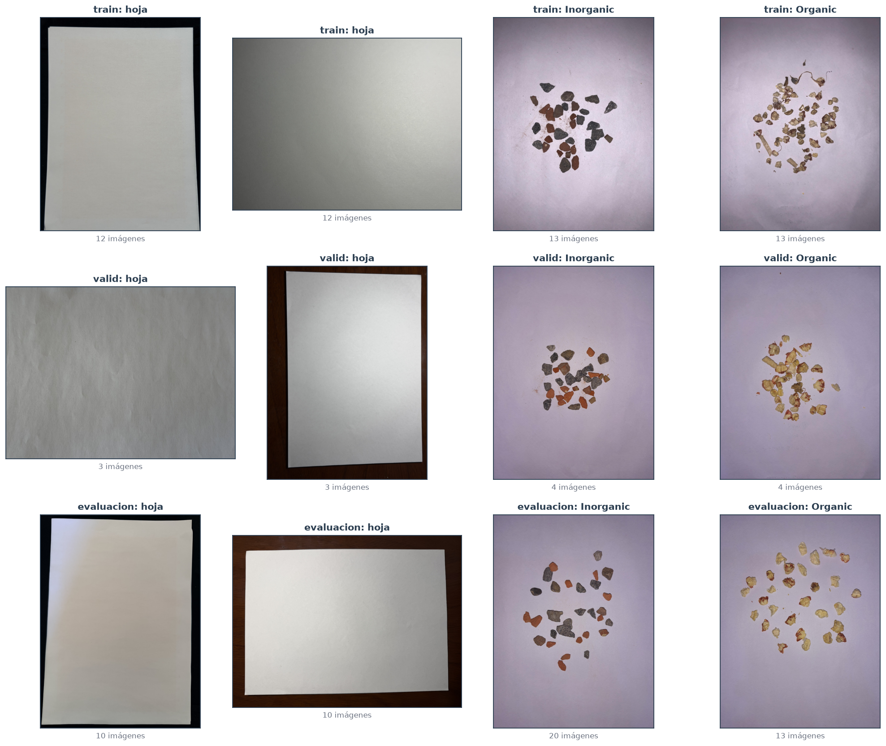
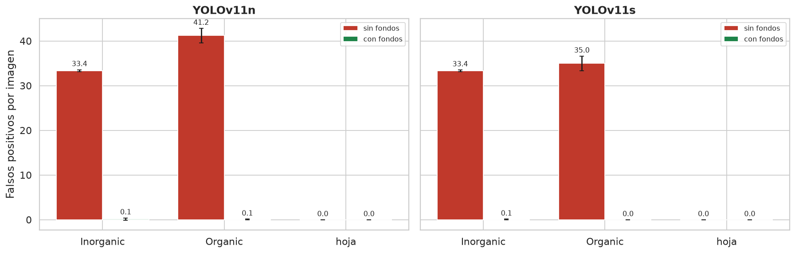
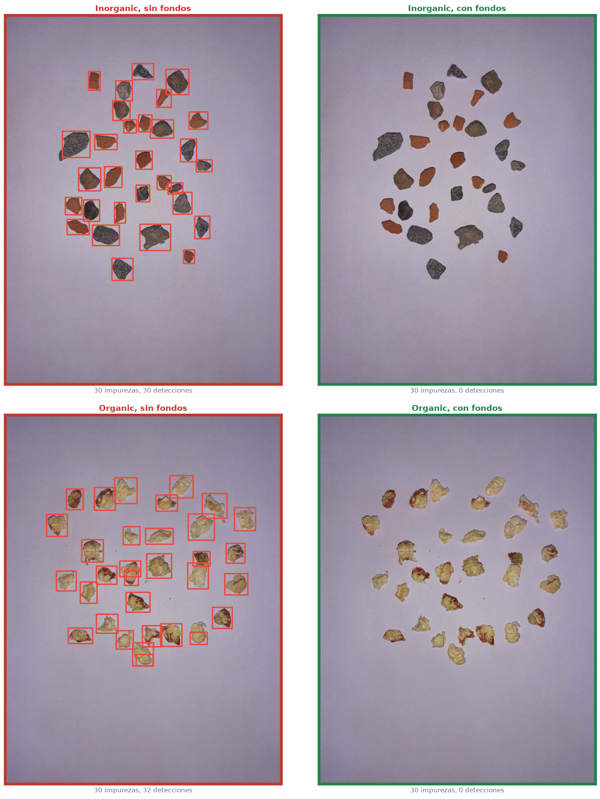
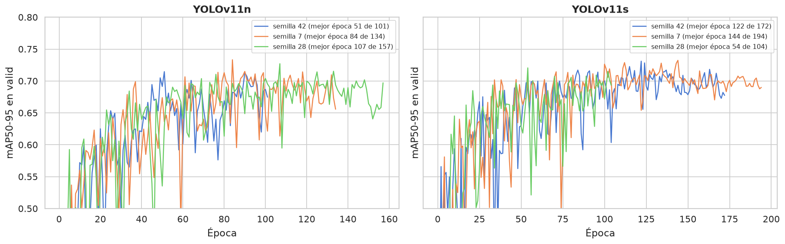

# Fondos Negativos: Dataset y Reentrenamiento

| | | | |
| :--- | :--- | :--- | :--- |
| **Proyecto:** | Detección de defectos en granos de maíz con YOLOv11 | **Fecha:** | 15 - 10 - 2026 |
| **Objetivo:** | Objetivo Específico 2, corrección de los falsos positivos sobre impurezas | **Notebooks:** | `2.2c_fondos_dataset.ipynb`, `2.2c_fondos_entrenamiento.ipynb` |
| **Datos:** | `Data_final` + `datos/fondos` (`datos/fondos/data.yaml`) | **Figuras:** | `salida/2.2c_fondos/` |
| **Registro:** | `resultados/experimentos/fondos.csv` | **Resultado:** | `resultados/configuracion_fondos.json`, `runs/oe2/*_fondos/weights/best.pt` |

---

## 1. Planteamiento

El diagnóstico de los modelos finales de la 2.2 (`2.2b_diagnostico_test.md`) mostró que detectan como grano entre el 90 % y el 98 % de las impurezas inorgánicas y orgánicas, casi siempre como `Defect`. El umbral de confianza no las separa de los granos.

La causa es que los modelos apenas vieron objetos que no fueran maíz durante el entrenamiento. La corrección consiste en añadir **fondos negativos**: imágenes sin granos con la etiqueta vacía, que enseñan a la red qué no es un grano.

## 2. Dataset de fondos

### 2.1. Fuentes

- **Hojas vacías:** se agregaron 25 fotos de fondo sin granos, tomadas en dos sesiones con distinta iluminación y encuadre; algunas muestran el borde de la mesa.
  - Se leen en su resolución original (de 4032 × 3024 a 5712 × 4284 px).
  - Sus metadatos (ubicación, fecha y dispositivo) se eliminaron.
- **Impurezas:** las 144 imágenes de `Data_corr_v6` que solo contienen impurezas inorgánicas (76) u orgánicas (68). Se retiraron en el OE1, y ningún modelo las había visto.
  - Las otras semillas no se usan: la clase se descartó en el OE1 por salir del objetivo.

### 2.2. Reglas

1. **Proporción:** los fondos son el 10 % de cada conjunto, el máximo que recomienda la documentación de Ultralytics para reducir falsos positivos (*Tips for Best Training Results*: 0-10 % de imágenes de fondo).
2. **Sin fuga por sesión de captura:** las impurezas se fotografiaron en las mismas sesiones que los granos. Se agrupan con los granos por lote, con el mismo criterio que en el OE1, y cada lote va a un solo destino:

   | Lote de las impurezas | Destino | Imágenes |
   | :--- | :--- | :---: |
   | Comparte sesión con granos del test | Evaluación | 33 |
   | Comparte sesión solo con granos de `valid` | `valid` | 8 |
   | Comparte sesión solo con granos de `train` | Candidatas a `train` | 58 |
   | Comparte sesión con granos de `train` y de `valid` | Descartadas | 45 |

3. **Hojas:** de cada sesión, la mitad va a `train`, un 15 % a `valid` y el resto a evaluación.
4. **Mismo formato que `Data_final`:** letterbox a 1280 px y relleno gris hasta un múltiplo de 32.

### 2.3. Resultado

| Conjunto | Hojas | Inorgánicas | Orgánicas | Fondos | Imágenes con granos | Fracción de fondos |
| :--- | :---: | :---: | :---: | :---: | :---: | :---: |
| `train` | 12 | 13 | 13 | 38 | 345 | 9.9 % |
| `valid` | 3 | 4 | 4 | 11 | 98 | 10.1 % |
| Evaluación | 10 | 20 | 13 | 43 | — | — |

- **Impurezas de `train`:** se eligieron 26 de las 58 candidatas, a partes iguales entre inorgánicas y orgánicas y repartidas entre los lotes.
- **Evaluación:** ese conjunto no se usa para entrenar ni para decidir, y el test de granos no cambia.
- **Verificación:** el cargador de Ultralytics lee los fondos como imágenes sin cajas (38 en `train` y 11 en `valid`). Ningún lote de evaluación comparte sesión con `train` o `valid`.

## 3. Reentrenamiento

**Protocolo:**
- **Configuración:** la adoptada en la 2.2: SGD con `lr0 = 0.01`, lote 16, aumento por defecto, 1280 px, hasta 200 épocas con `patience = 50`.
- **Datos:** `Data_final` más los fondos.
- **Semillas:** las mismas del entrenamiento final de la 2.2 (42, 7 y 28), así que cada modelo con fondos tiene un par sin fondos.
- **Sesiones:** se entrenó primero la semilla 42, como lectura preliminar, y después las semillas 7 y 28.
- **Métricas:** se calculan sobre los granos de `valid` (las 98 imágenes de `Data_final`), comparables con las de la 2.2.

**Regla de decisión, fijada antes de entrenar.** Para cada modelo, los fondos se adoptan si se cumplen las dos condiciones, con las medias de las 3 semillas:
1. los falsos positivos por imagen en las impurezas de `valid` bajan al menos un 90 %;
2. el mAP50-95 en los granos de `valid` no cae más de 0.005.

## 4. Resultados

### 4.1. Impurezas de `valid` y decisión

| Modelo | Falsos positivos por imagen, sin fondos | Con fondos | Reducción | Diferencia de mAP50-95 en granos | Decisión |
| :--- | :---: | :---: | :---: | :---: | :---: |
| YOLOv11n | 34.6 | 0.3 | **−99 %** | **+0.014** | Se adoptan |
| YOLOv11s | 31.6 | 0.2 | **−99 %** | **+0.008** | Se adoptan |

Las 3 hojas vacías de `valid` no tienen detecciones en ninguna versión.

### 4.2. Conjunto de evaluación

Impurezas de las sesiones del test y hojas no usadas en el entrenamiento, nunca vistas por ninguna versión.

| Modelo | Tipo | Falsos positivos por imagen, sin → con fondos | Impurezas detectadas como grano, sin → con fondos |
| :--- | :--- | :---: | :---: |
| YOLOv11n | Inorgánica | 33.4 → 0.15 | 99.1 % → 0.5 % |
| | Orgánica | 41.2 → 0.05 | 96.8 % → 0.1 % |
| YOLOv11s | Inorgánica | 33.4 → 0.05 | 99.4 % → 0.1 % |
| | Orgánica | 35.0 → 0 | 94.1 % → 0 % |
| Ambos | Hoja | 0 → 0 | — |

En imágenes nunca vistas, los modelos con fondos dejan de detectar las impurezas: de unas 35 detecciones por imagen se pasa a menos de una cada seis imágenes.

### 4.3. Granos de `valid`

| Métrica | YOLOv11n sin | YOLOv11n con | Diferencia (mejor en n de 3) | YOLOv11s sin | YOLOv11s con | Diferencia (mejor en n de 3) |
| :--- | :---: | :---: | :---: | :---: | :---: | :---: |
| mAP50-95 | 0.713 | 0.727 | +0.014 (3) | 0.721 | 0.729 | +0.008 (3) |
| mAP50 | 0.960 | 0.965 | +0.004 (1) | 0.958 | 0.963 | +0.005 (3) |
| mAP75 | 0.844 | 0.869 | +0.025 (3) | 0.856 | 0.871 | +0.016 (2) |
| Precisión | 0.863 | 0.879 | +0.016 (2) | 0.885 | 0.876 | −0.009 (2) |
| Recall | 0.921 | 0.921 | −0.001 (2) | 0.910 | 0.929 | +0.019 (2) |
| MAE de conteo | 0.476 | 0.361 | −0.116 (2) | 0.398 | 0.463 | +0.065 (1) |
| Umbral de conteo | 0.398 | 0.506 | | 0.454 | 0.417 | |

*Medias de las 3 semillas; diferencia emparejada por semilla. Entre paréntesis, en cuántas semillas la versión con fondos es mejor. El umbral de conteo es la mediana de los umbrales de máximo F1.*

**Los fondos no empeoran la detección de granos.**
- El mAP50-95 sube en los dos modelos y en las 3 semillas.
- Las diferencias en el resto de métricas son del orden de la variación entre semillas.
- El MAE de conteo mejora en YOLOv11n y empeora ligeramente en YOLOv11s (+0.07 granos por imagen).

**Por subtipo, los cambios son mixtos** y en su mayoría están dentro de la variación entre semillas: la desviación de las diferencias va de 0.03 a 0.21. Hay dos tendencias consistentes:
- **YOLOv11n:** baja algo el acierto en `Broken` (−0.033) y `Shriveled` (−0.031), en las 3 semillas.
- **YOLOv11s:** sube en `Shriveled` (+0.050, en las 3 semillas) y en `Damage` (+0.086).

### 4.4. Convergencia y costo

*El `valid` del entrenamiento incluye los fondos, así que estas curvas no son directamente comparables con las de la 2.2.*

- **Convergencia:** todas las corridas se detuvieron por `patience` antes de las 200 épocas, entre las épocas 101 y 194.
- **Costo:** 6 corridas, 1.2 h de A100.
- **VRAM:** unos 21 GB con YOLOv11n y 25 GB con YOLOv11s.

## 5. Conclusiones

1. **Los fondos negativos corrigen el problema de las impurezas.** En impurezas nunca vistas, la detección como grano baja del 94–99 % a menos del 1 % en los dos modelos.
2. **No hay costo en la detección de granos.** El mAP50-95 en `valid` sube +0.014 en YOLOv11n y +0.008 en YOLOv11s, y los cambios en el conteo y por subtipo son del orden de la variación entre semillas.
3. **Nuevos modelos finales:** se adoptan los modelos con fondos. Su configuración, sus umbrales de conteo (0.506 en YOLOv11n y 0.417 en YOLOv11s) y las rutas de sus 3 `best.pt` están en `resultados/configuracion_fondos.json`.
4. **Lo que los fondos no abordan:** la confusión de granos sanos como `Defect` en escenas mezcladas, que señaló el diagnóstico, no depende de las impurezas. Su causa se analiza en `2.2d_fotos_propias.md`.
