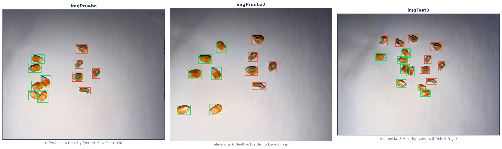
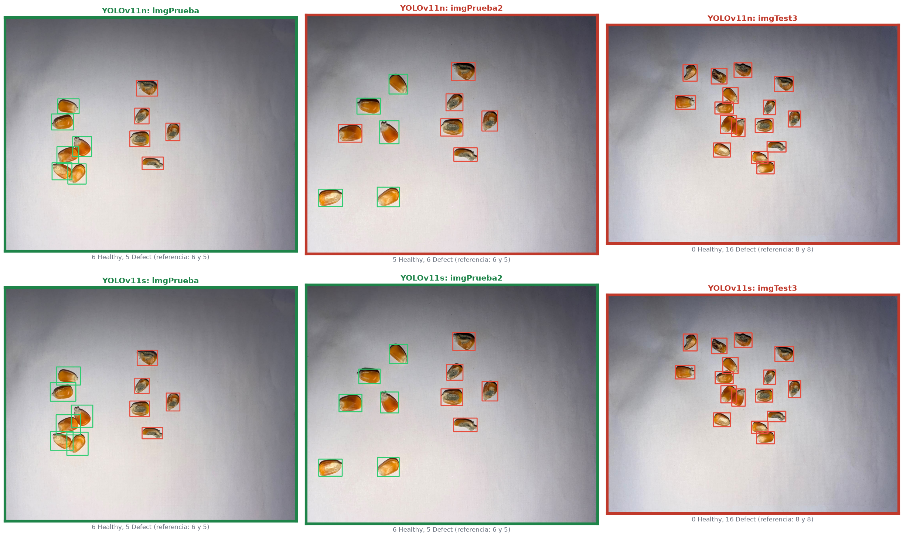
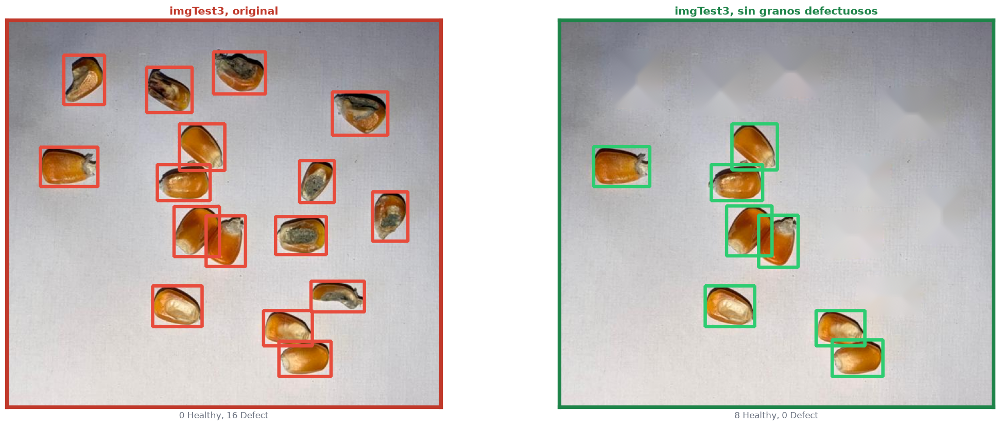
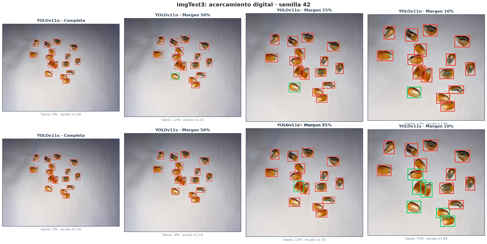
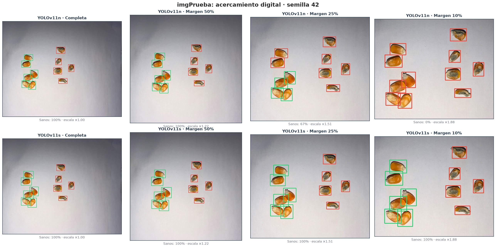
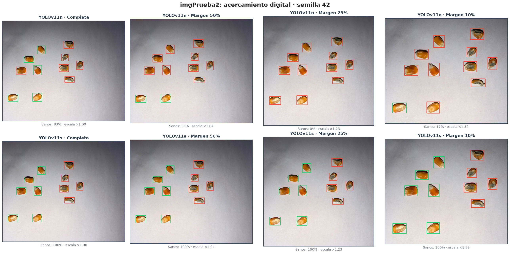
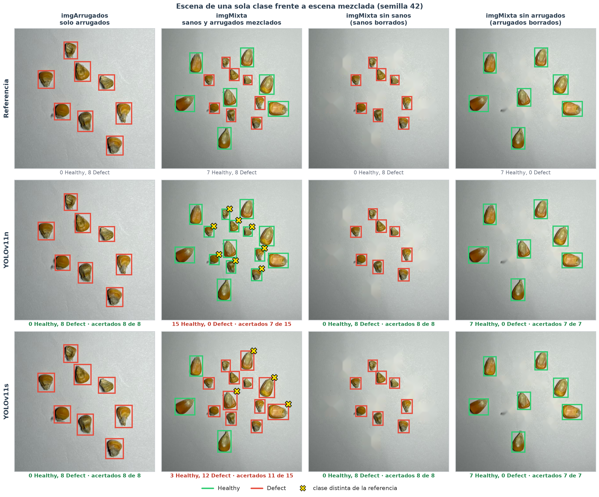

# Comportamiento de los Modelos con Fotos Propias

| | | | |
| :--- | :--- | :--- | :--- |
| **Proyecto:** | Detección de defectos en granos de maíz con YOLOv11 | **Fecha:** | 15 - 10 - 2026 |
| **Objetivo:** | Objetivo Específico 2, comportamiento fuera del dataset | **Notebook:** | `2.2d_fotos_propias.ipynb` |
| **Modelos:** | `configuracion_fondos.json`: YOLOv11n y YOLOv11s con fondos negativos, 3 semillas cada uno | **Figuras:** | `salida/2.2d_fotos_propias/` |
| **Datos:** | 5 fotos propias tomadas con smartphone (`fotos/propias/`) y su referencia (`fotos/propias/referencia/`) | | |

---

## 1. Planteamiento

Los modelos finales se aplican a fotos tomadas con smartphone fuera del dataset: otra cámara, otra iluminación y otros granos. El objetivo es comprobar si su comportamiento se mantiene en esas condiciones y, donde falle, explorar los factores asociados.

| Foto | Tamaño | Granos | Sanos | Defectuosos | Disposición |
| :--- | :---: | :---: | :---: | :---: | :--- |
| `imgPrueba` | 1496 × 1200 | 11 | 6 | 5 | Sanos a la izquierda, defectuosos a la derecha |
| `imgPrueba2` | 1463 × 1200 | 11 | 6 | 5 | Los mismos granos, en otra disposición separada |
| `imgTest3` | 1280 × 960 | 16 | 8 | 8 | Sanos y defectuosos mezclados |
| `imgArrugados` | 960 × 1280 | 8 | 0 | 8 | Solo granos arrugados (`Shriveled`) |
| `imgMixta` | 960 × 1280 | 15 | 7 | 8 | Sanos grandes y arrugados pequeños, mezclados |

`imgArrugados` e `imgMixta` se analizan en la sección 8; las demás secciones usan las tres primeras fotos.

**Referencia:**
- **Cajas:** el consenso de las detecciones de las 6 corridas, es decir, la mediana de las cajas que coinciden en al menos 4 corridas.
- **Clase:** asignada por inspección visual. `Defect` si el grano tiene moho, está partido o tiene manchas; `Healthy` en otro caso.

**Criterios:** como en el diagnóstico del test, con el umbral de conteo de cada modelo y NMS agnóstico a la clase. Un grano está acertado si una predicción lo cubre con IoU ≥ 0.5 y con la clase correcta.

## 2. Diferencias con `Data_final`

| | Lado del grano a 1280 px | Tono (H) del grano | Brillo (V) del grano | Brillo del papel | Calidad JPEG |
| :--- | :---: | :---: | :---: | :---: | :--- |
| `Data_final` train (p5–p95) | 26–82 | 28–62 | 128–221 | 160–199 | 75, con originales de 3000 a 4600 px |
| `imgPrueba` | 84 | 26 | 183 | 172 | 85, a 1496 × 1200 px |
| `imgPrueba2` | 85 | 31 | 168 | 171 | 85, a 1463 × 1200 px |
| `imgTest3` | 67 | 34 | 163 | 175 | 75, a 1280 × 960 px |

- **Tamaño del grano:** en las tomas cercanas está en el borde superior del rango de entrenamiento.
- **Color:** los granos son más anaranjados (tono bajo) que la mayoría de los del dataset.
- **Compresión:** `imgTest3` tiene la compresión del dataset, pero sobre una imagen de menor resolución.

Ninguna de las tres fotos queda claramente fuera del rango de entrenamiento.

## 3. Conteo y clasificación

| Foto | Modelo | Detecciones (referencia) | Sanos acertados | Defectuosos acertados |
| :--- | :--- | :---: | :---: | :---: |
| `imgPrueba` | YOLOv11n | 11, 10, 11 (11) | 100 % | 93 % |
| | YOLOv11s | 12, 11, 11 (11) | 100 % | 100 % |
| `imgPrueba2` | YOLOv11n | 11, 11, 11 (11) | 94 % | 100 % |
| | YOLOv11s | 11, 11, 11 (11) | 89 % | 100 % |
| `imgTest3` | YOLOv11n | 16, 16, 16 (16) | **25 %** | 100 % |
| | YOLOv11s | 16, 16, 16 (16) | **0 %** | 100 % |

*Detecciones de las semillas 7, 28 y 42; aciertos, media de las 3 semillas.*

- **Conteo:** se mantiene fuera del dataset. Todas las corridas cuentan los granos con un error de 1 como máximo.
- **Defectos:** se reconocen entre el 93 % y el 100 %, según la foto y el modelo.
- **Clasificación en las tomas con los grupos separados:** es casi perfecta.
- **En `imgTest3`, con los granos mezclados, los sanos se clasifican como `Defect`:**
  - YOLOv11s falla los 8 granos sanos con las 3 semillas;
  - YOLOv11n los falla todos con dos semillas y acierta 6 de 8 con la tercera.

## 4. Exploración de factores asociados al fallo en `imgTest3`

Se probaron, solo con inferencia, los factores que distinguen a `imgTest3` de las otras fotos.

**¿Qué corrige `imgTest3`?** Sanos acertados, media de las 3 semillas:

| Prueba | YOLOv11n | YOLOv11s |
| :--- | :---: | :---: |
| Original | 25 % | 0 % |
| Balance de blancos *gray world* | 21 % | 0 % |
| Saturación × 0.65 | 25 % | 0 % |
| Inferencia a 960 / 1600 / 1920 px | 17 % / 33 % / 42 % | 17 % / 12 % / 17 % |
| **Granos defectuosos borrados de la imagen** | **100 %** | **100 %** |

Con los granos sanos borrados, los defectuosos se siguen reconociendo: 96 % con YOLOv11n y 100 % con YOLOv11s.

**¿Qué rompe `imgPrueba`?** Sanos acertados:

| Prueba | YOLOv11n | YOLOv11s |
| :--- | :---: | :---: |
| Original | 100 % | 100 % |
| JPEG calidad 50 / 30 | 94 % / 67 % | 100 % / 100 % |
| Desenfoque σ 1.5 / 2.5 | 100 % / 100 % | 100 % / 100 % |

**La modificación del contexto cambió las predicciones.** Al borrar los defectuosos, los ocho sanos se clasificaron correctamente en las seis corridas. Los ajustes de color y las resoluciones de inferencia ensayadas no resolvieron todos los errores. Estas intervenciones mostraron sensibilidad a la escena, pero no aislaron una causa única. El análisis adicional de recortes (sección 7) sí encontró una mejora importante de YOLOv11s al acercar el encuadre.

**Proximidad entre clases y representación en entrenamiento:**

| | Granos sanos en escenas con las dos clases | Sanos a menos de 2 lados de grano de un defectuoso | Distancia mediana al defectuoso más cercano |
| :--- | :---: | :---: | :---: |
| `Data_final` train | 8 % de 5 963 | 98 % de 484 | 0.9 lados |
| `imgPrueba` | 6 de 6 | 0 % | 3.9 lados |
| `imgPrueba2` | 6 de 6 | 0 % | 4.5 lados |
| `imgTest3` | 8 de 8 | 62 % | 1.8 lados |

- **En las fotos:** en las tomas que funcionan, ningún grano sano está cerca de un defectuoso; en `imgTest3`, la mayoría sí.
- **En el entrenamiento:** el 89 % de las imágenes de `train` tiene granos de una sola clase. Solo el 8 % de los granos sanos aparece en una escena con granos defectuosos.
- **Interpretación:** la escasez de escenas mixtas es una posible limitación de generalización. Estos datos describen una asociación y no demuestran que sea la única causa del fallo.

Este patrón coincide con el diagnóstico del test: todos los errores sistemáticos estaban en el único lote con bandejas mezcladas, y eran granos `Healthy` predichos como `Defect`.

## 5. Conclusiones

1. En las fotos completas, el conteo presentó un error máximo de un grano y el acierto de defectuosos fue del 93–100 %, según foto y modelo.
2. La clasificación de sanos fue peor en la escena mezclada. Borrar los defectuosos cambió las predicciones de los sanos, lo que mostró sensibilidad al contexto.
3. El acercamiento del encuadre también influyó: en imgTest3, YOLOv11s pasó de 0 % a 83.3 % de sanos acertados. YOLOv11n no mejoró de forma sostenida y algunos recortes redujeron su capacidad de detección.
4. La composición del dataset es una posible limitación: abundan las escenas monoclase y pocos granos sanos aparecen junto a defectuosos. El análisis no demuestra una causa exclusiva ni separa los efectos de escala y contexto.
5. El desbalance de subtipos existe, pero no se ha demostrado que explique estos errores de sanos predichos como Defect.
6. En una escena mezclada con granos de tamaño normal, cada modelo tendió a asignar una sola clase a casi todos los granos (sección 8): YOLOv11n marcó como sanos casi todos los arrugados y YOLOv11s, como defectuosos casi todos los sanos. Separados, ambos grupos se clasificaron correctamente.
7. El alcance es exploratorio: solo hay cinco fotos, dos de ellas con los mismos granos; las clases se revisaron visualmente y las cajas de referencia proceden del consenso de los modelos. Las tres semillas no equivalen a nuevas escenas independientes.

## 6. Decisión: ampliar el dataset con fotos propias

Las intervenciones de inferencia produjeron mejoras parciales y dependientes del modelo; no proporcionaron una solución uniforme. Se decidió ampliar el entrenamiento con fotos propias tomadas con smartphone para incorporar mayor diversidad de escenas y encuadres. La toma de fotos combina tres tipos de escena:
1. **Fotos de un solo subtipo**, de cada subtipo de maíz (`Broken`, `Damage`, `Fungus`, `Healthy`, `Immature`, `Shriveled` y `Weeveled`). Aportan la cámara y las condiciones de uso propias, con la misma estructura del dataset original.
2. **Más fotos de los subtipos minoritarios del dataset original**, para reducir el desbalance de subtipos. No se ha demostrado que explique los fallos observados, pero sí es una característica del dataset.
3. **Fotos multiclase**, con granos sanos y defectuosos mezclados en la misma escena y próximos entre sí. Cubren la situación que hoy falla y que el dataset original apenas contiene.

**Aumento C.** En la 2.2 no se confirmó como mejora general, y quedó como candidato para las fotos propias. Se evalúa con el dataset ampliado, no con el actual, por dos razones:
- las pruebas de la sección 4 no mostraron que los ajustes fotométricos ensayados resolvieran el fallo; esto no permite anticipar el efecto de entrenar con el aumento C;
- con el dataset ampliado, la validación incluirá fotos de smartphone, donde el efecto del aumento C podrá evaluarse sobre un conjunto mayor y separado del entrenamiento.

## 7. Comprobación adicional del encuadre

Se comparó cada foto completa con recortes de margen 50 %, 25 % y 10 % alrededor de todos los granos. Se conservaron las tres semillas, los umbrales y la resolución de inferencia (1280).

Valores medios de las tres semillas (42, 7 y 28), con los mismos modelos y umbrales. El acierto exige detección con IoU ≥ 0.5 y clase correcta.

| Encuadre de imgTest3 | Ampliación relativa | Lado mediano a 1280 (px) | Sanos acertados: YOLOv11n | Sanos acertados: YOLOv11s | Defectuosos acertados: YOLOv11n | Defectuosos acertados: YOLOv11s |
| :--- | ---: | ---: | ---: | ---: | ---: | ---: |
| Completa | 1.00 | 67.3 | 25.0 % | 0.0 % | 100 % | 100 % |
| Margen 50 % | 1.16 | 78.3 | 29.2 % | 8.3 % | 100 % | 100 % |
| Margen 25 % | 1.55 | 104.5 | 41.7 % | 29.2 % | 100 % | 100 % |
| Margen 10 % | 1.94 | 130.4 | 33.3 % | 83.3 % | 95.8 % | 100 % |

**YOLOv11s fue sensible al encuadre.** En imgTest3, el recorte con margen del 10 % aumentó el acierto de los sanos en 83.3 puntos porcentuales. Las tres semillas acertaron 6/8, 7/8 y 7/8 sanos (42, 7 y 28), respectivamente. Detectaron los 16 granos sin predicciones sin pareja y acertaron los ocho defectuosos en todos los casos. Los errores de clase bajaron de 8 a 1.33 por imagen, en promedio.

**YOLOv11n no mejoró de forma sostenida.** Alcanzó su mayor acierto de sanos en imgTest3 con margen del 25 % (41.7 %), sin pérdidas de detección. Con margen del 10 % bajó a 33.3 %, con un grano no detectado de media y 95.8 % de acierto en defectuosos. No se observó una mejora uniforme al aumentar el acercamiento.

**El efecto también dependió de la foto.** En imgPrueba, YOLOv11n pasó de 100 % a 44.4 % de sanos acertados con el recorte más cercano, y los no detectados aumentaron de 0.33 a 2.33 por imagen. En imgPrueba2 pasó de 94.4 % a 72.2 %. YOLOv11s conservó el 100 % de acierto en ambas clases en todos los recortes de estas dos fotos, aunque en imgPrueba con margen del 10 % hubo 0.33 predicciones sin pareja de media.

**Interpretación.** El tamaño aparente y el encuadre influyeron en las predicciones, especialmente en YOLOv11s; por tanto, las pruebas previas de imgsz no permitían descartar la escala. Sin embargo, recortar también retira fondo, altera el contexto y cambia el preprocesamiento de la imagen. No separa esos efectos ni añade detalle óptico. El acercamiento no resolvió todos los errores y perjudicó a YOLOv11n en algunas condiciones: no constituye una solución general ni demuestra que la distancia física de captura sea la única causa.

La mejora tras borrar los defectuosos y la mejora tras recortar son evidencias complementarias de sensibilidad a la escena. Con tres fotos, dos de ellas de los mismos granos, no permiten atribuir causalidad exclusiva a la composición del dataset. La ampliación con escenas mixtas y distintos encuadres sigue siendo una decisión razonable, que requiere validación con imágenes independientes.

## 8. Escena de una sola clase frente a escena mezclada

Dos fotos adicionales aíslan el efecto de mezclar clases: `imgArrugados` (8 granos arrugados, una sola clase) e `imgMixta` (7 sanos grandes y 8 arrugados pequeños). En ambas, el grano mide de 51 a 55 px a 1280, alrededor de la mediana del entrenamiento (52 px), por lo que la escala no se aparta de lo visto en el entrenamiento. Sobre `imgMixta` se repitió la prueba de contexto de la sección 4: se borraron por *inpainting* los sanos o los arrugados, y se evaluaron los granos restantes.

| Escena | Sanos acertados: YOLOv11n | Sanos acertados: YOLOv11s | Arrugados acertados: YOLOv11n | Arrugados acertados: YOLOv11s | Clase mayoritaria: YOLOv11n | Clase mayoritaria: YOLOv11s |
| :--- | ---: | ---: | ---: | ---: | ---: | ---: |
| `imgArrugados` | — | — | 100 % | 100 % | 1,00 | 1,00 |
| `imgMixta` | 95 % | 24 % | 25 % | 100 % | 0,83 | 0,89 |
| `imgMixta` sin sanos | — | — | 100 % | 100 % | 1,00 | 1,00 |
| `imgMixta` sin arrugados | 100 % | 100 % | — | — | 1,00 | 1,00 |

*Media de las tres semillas. Clase mayoritaria: fracción de las predicciones de cada corrida que pertenece a la clase más frecuente; 1,00 indica que todos los granos recibieron la misma clase.*

*La primera fila es la referencia y las otras dos, las predicciones de cada modelo. El color de la caja indica la clase (verde `Healthy`, rojo `Defect`) y la X amarilla, un grano clasificado con una clase distinta de la referencia. Las manchas claras de las dos últimas columnas son las zonas borradas por inpainting.*

**Separados, ambos grupos se clasificaron bien.** En `imgArrugados` y en las dos versiones de `imgMixta` con un solo grupo, los seis modelos acertaron todos los granos.

**Mezclados, cada modelo tendió a una sola clase.** En `imgMixta`, YOLOv11n clasificó como sanos casi todos los granos (con dos semillas, los 15) y acertó solo el 25 % de los arrugados; YOLOv11s clasificó como defectuosos casi todos (con la semilla 7, los 15) y acertó el 24 % de los sanos. Los dos modelos fallaron en direcciones opuestas sobre la misma imagen.

**Interpretación.** Los mismos granos cambiaron de clase según estuvieran solos o acompañados de la otra clase, con un tamaño aparente dentro del rango de entrenamiento. Esto refuerza la sensibilidad a la composición de la escena observada en `imgTest3` y es coherente con un dataset de entrenamiento compuesto sobre todo por bandejas de una sola clase. Como en las secciones anteriores, el análisis es exploratorio y no demuestra una causa única; la ampliación con escenas mezcladas permitirá comprobarlo con un conjunto independiente.
