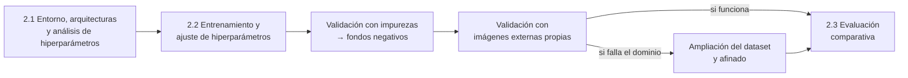

# Plan del OE2: Actividades 2.1 y 2.2

| | |
| :--- | :--- |
| **Objetivo específico 2 (PIIC, no cambia)** | Entrenar los modelos YOLOv11n y YOLOv11s en un entorno controlado mediante transferencia de aprendizaje y el ajuste de hiperparámetros para la identificación, clasificación y conteo de granos de maíz sanos y con defectos superficiales, evaluando su desempeño mediante el registro de métricas de precisión, recall, mAP@0.5 y tiempo de inferencia. |
| **Punto de partida** | `datos/Data_final` (OE1): 1280 px, sin normalización fotométrica, sin balanceo, partición por lote (train 345 / valid 98 / test 70) |
| **Alcance** | Actividades 2.1 y 2.2, rediseñadas (las actividades se pueden ajustar; el objetivo no). Versión de referencia: Ultralytics 8.4.174 y su documentación oficial. |

---

## 1. Hoja de ruta del OE2

Este plan detalla la 2.1 y la 2.2. Los pasos siguientes se decidieron con las evidencias de cada etapa:
- **Impurezas → fondos negativos:** los modelos detectaban casi todas las impurezas como granos. Con los fondos negativos dejan de hacerlo, y se adoptaron (`2.2c_fondos_negativos.md`).
- **Imágenes externas propias:** el conteo y el reconocimiento de defectos se mantienen, pero los granos sanos próximos a granos defectuosos se clasifican como `Defect`. El fallo mostró sensibilidad al contexto de la escena y al encuadre, y el dataset original casi no tiene escenas mezcladas. Se amplía el dataset con fotos propias, con escenas mezcladas y distintos encuadres; la toma de fotos y el tratamiento del aumento C están en `2.2d_fotos_propias.md` (sección 6).

## 2. Principios, heredados del OE1

1. **El test no se usa para ajustar.** Todas las decisiones de la 2.2 se tomaron con validación. Después de la 2.2, el test se usó una vez para diagnosticar los modelos finales (`2.2b_diagnostico_test.ipynb`), sin cambiarlos.
2. **Un factor por paso**, con reglas fijadas antes de entrenar, en lugar de una búsqueda automática de hiperparámetros.
3. **Hiperparámetros descartados con evidencia**, no por intuición: el análisis de la 2.1 explica cada uno.
4. **Misma GPU para todas las corridas**, con el registro y la descarga ya probados en las 56 corridas del OE1.
5. **Resolución común de 1280 px** para los dos modelos. Se eligió con YOLOv11s; que también sea adecuada para YOLOv11n se asume y se declara como limitación.

## 3. Actividad 2.1: Entorno, arquitecturas y análisis de hiperparámetros

**Entregables:**
- el script de configuración del entorno y carga de las arquitecturas;
- el análisis de los hiperparámetros disponibles;
- el diseño experimental de la 2.2, fijado antes de entrenar.

### 3.1. Notebook `2.1_entorno_arquitecturas.ipynb` (sin entrenar)

1. **Entorno reproducible:**
   - versiones de Python, PyTorch, CUDA, Ultralytics 8.4.174 y Albumentations 2.0.8, en local y en Colab;
   - GPU y memoria disponibles;
   - semilla y modo determinista.
2. **Arquitecturas y transferencia de aprendizaje:**
   - carga de `yolo11n.pt` y `yolo11s.pt`, preentrenados en COCO;
   - parámetros, capas y GFLOPs a 1280 px;
   - qué se transfiere de COCO y qué se reinicia: la cabeza pasa de 80 clases a 2.
3. **Perfil de hardware.** Con lotes reales de `Data_final` a 1280 px y una pasada de entrenamiento simulada (adelante y atrás, sin guardar nada), se miden la VRAM y el tiempo por iteración de cada modelo con lotes de 4, 8 y 16, para documentar qué cabe en cada GPU.

   El lote 32 se descarta por memoria: con lote 16, YOLOv11s ya necesita unos 23 GB a 1280 px, y el doble superaría los 40 GB de la A100.

### 3.2. Notebooks `2.1_hiperparametros.ipynb` (incluye el aumento nativo de Ultralytics) y `2.1_aumento_datos.ipynb` (transformaciones de Albumentations): análisis con evidencias

Clasifica **todos** los hiperparámetros de entrenamiento de Ultralytics 8.4.174 en cuatro grupos. Cada decisión lleva una justificación y, cuando corresponde, una evidencia visual o numérica sobre imágenes reales de `Data_final`.

| Grupo | Hiperparámetros | Justificación y evidencia |
| :--- | :--- | :--- |
| **Se ajustan en la 2.2** | `optimizer`, `lr0`; aumento: transformaciones de Albumentations (`augmentations`), `flipud` y giros de 90° | Sección 4. *Evidencia:* cada transformación de Albumentations aplicada a un grano real, y por qué se reemplazan las cuatro que Ultralytics aplica por defecto. |
| **Se desactivan o descartan** | `bgr` | Intercambia los canales: el grano amarillo se vuelve azulado. El color distingue defectos como `Fungus`, y en el OE1 alterar el color (variante `norm`) redujo la precisión. *Evidencia:* imagen original frente a la intercambiada. |
| | `degrees`, `shear`, `perspective` | Al girar o deformar la imagen, la caja alineada a los ejes se agranda para contener al grano girado, e incluye fondo. *Evidencia:* aumento medio del área de las cajas reales a 10°, 30° y 45°, con figura antes y después. La cámara es cenital y fija, y la documentación oficial recomienda omitir las transformaciones geométricas en ese caso. |
| | `mixup` | Mezcla dos imágenes al 50 % (Beta(32, 32)): los granos quedan semitransparentes y los defectos superficiales, ambiguos. *Evidencia:* ejemplo mezclado. |
| | `cutmix` | Pega regiones de otra imagen y conserva cajas con solo el 10 % de su área: un grano recortado puede perder la zona del defecto y seguir etiquetado como `Defect`. *Evidencia:* ejemplo con cajas recortadas. |
| | `copy_paste` | Requiere polígonos (segmentación u OBB); con cajas no se aplica. |
| | `cls_pw` (pesos por clase) | Las clases están casi equilibradas (Defect/Healthy = 1.14), y el balanceo no tuvo efecto en el OE1. |
| **Se mantienen por defecto** | `mosaic`, `close_mosaic`, `fliplr`, `translate`, `scale`, `hsv_h`, `hsv_s`, `hsv_v` | Son el aumento validado en el OE1 (+0.041 de mAP50-95 frente a sin aumento). `hsv_h` = 0.015 equivale a ±5° de tono. *Evidencia:* ejemplos con los valores extremos. |
| | `lrf`, `momentum`, `weight_decay`, `warmup_*`, `cos_lr`, `box`, `cls`, `dfl`, `nbs`, `iou`, `max_det` | Hiperparámetros secundarios: se mantienen por defecto para no multiplicar el diseño. `max_det` = 300 basta, porque el máximo es de 98 granos por imagen. Los pesos de la pérdida (`box`, `cls`, `dfl`) son valores equilibrados; pueden ajustarse en el futuro si el modelo falla en la detección o en la clasificación. |
| **No aplican** | `auto_augment`, `erasing`, `dropout` (solo clasificación); `overlap_mask`, `mask_ratio` (solo segmentación); `pose`, `kobj`, `angle` y los de profundidad | Otras tareas. |
| | `cache`, `workers`, `amp`, `compile`, `channels_last`, `deterministic` | Rendimiento y reproducibilidad, sin efecto en el modelo; se fijan para todas las corridas. |
| | `freeze`, `multi_scale` | `freeze`: se afinan todas las capas, porque los granos de maíz están lejos de las clases de COCO. `multi_scale` cambia la resolución de cada lote entre ×(1 − valor) y ×(1 + valor), con más memoria (con 0.25, hasta 1600 px), y `scale` ya varía el tamaño del grano. |

## 4. Actividad 2.2: Entrenamiento y ajuste de hiperparámetros

### 4.1. Factores

| Factor | Valores que se prueban | Notas |
| :--- | :--- | :--- |
| **Optimizador** | SGD, MuSGD, Adam, AdamW | Cada uno con su tasa estándar según la documentación: 0.01 para SGD y MuSGD, 0.001 para Adam y AdamW. Compararlos con la misma tasa sería injusto. El modo `'auto'`, que con menos de 10 000 iteraciones elige AdamW con lr ≈ 0.0017, queda cubierto por AdamW. |
| **Tasa de aprendizaje** | ×0.5 y ×2 de la tasa estándar del optimizador elegido | Por debajo y por encima del valor estándar. |
| **Aumento en línea** | A: por defecto (referencia); B: A + Albumentations; C: B + volteo vertical y giros de 90° | Ver la sección 4.2. |

**Tamaño de lote: no se ajusta.** Ultralytics acumula gradientes hasta un lote nominal de 64 (`nbs = 64`, verificado en el código del entrenador), así que el lote cambia sobre todo la velocidad, la memoria y las estadísticas de BatchNorm. Se usa el valor por defecto de Ultralytics, **16**, en la confirmación y en el entrenamiento final; el cribado se ejecutó con lote 8, el del protocolo del OE1.

**Épocas.** Se usan valores estándar en vez de buscarlas:
- **100 épocas** (el valor por defecto de Ultralytics) en todas las corridas de ajuste, para comparar configuraciones con el mismo presupuesto;
- **200 épocas con `patience = 50`** en el entrenamiento final. Las curvas de esas corridas documentan si convergen.

### 4.2. Aumento en línea

**Configuración A (referencia).** El aumento por defecto de Ultralytics, validado en el OE1:
- mosaico, volteo horizontal, escala, traslación y HSV;
- con Albumentations instalado, también `Blur`, `MedianBlur`, `ToGray` y `CLAHE`, cada una con p = 0.01.

Por defecto **no** hay volteo vertical (`flipud = 0.0`) ni giros (`degrees = 0.0`).

**Configuración B: + Albumentations.** La lista que se pasa en `augmentations` **reemplaza** a las cuatro transformaciones por defecto (documentación oficial); el resto del aumento sigue activo. Se usa un conjunto propio, fotométrico y suave, que no deforma la imagen:

| Familia | Transformaciones | p | Qué aporta |
| :--- | :--- | :---: | :--- |
| Brillo y contraste | Una de `RandomGamma` (gamma 75 a 125) o `RandomToneCurve` (scale 0.25) | 0.35 | Exposición y curva tonal de distintas cámaras, sin acumularse con `hsv_v` |
| Nitidez | Una de `Sharpen` (alpha 0.25 a 0.40, lightness 0.95 a 1.05) o `Defocus` (radio 2 a 4) | 0.40 | Bordes más nítidos o desenfoque leve de una toma a mano; nunca ambos |
| Ruido del sensor | `GaussNoise` (std 0.06 a 0.12) | 0.20 | Ruido con poca luz |
| Compresión | `ImageCompression` (calidad 80 a 95) | 0.15 | Artefactos JPEG |

Dentro de cada `OneOf`, Albumentations aplica como máximo una transformación, así que no se acumulan dos del mismo tipo en una imagen.

Al reemplazar las transformaciones por defecto, desaparecen `ToGray` (elimina el color, que distingue defectos) y `CLAHE` (altera el color y el contraste del grano). `Blur` y `MedianBlur` no se incluyen: son de la misma familia que `Defocus`, que es la que simula el desenfoque de la lente (evidencia en `2.1_aumento_datos.ipynb`).

**Configuración C: + Albumentations y geométrico exacto.** Añade `flipud = 0.5` y `A.RandomRotate90(p = 0.5)` dentro de la misma lista. Como cada aumento decide por su cuenta si se aplica, la geometría y la fotometría se combinan en la misma imagen. En una vista cenital el grano no tiene orientación preferente, y estas transformaciones mueven las cajas **sin agrandarlas**, a diferencia de `degrees`.

### 4.3. Procedimiento en tres fases

Probar cada configuración en los 4 pliegues sería unas 100 corridas. Para no gastar recursos en configuraciones que no destacan, el ajuste se hace en fases. Cada fase se ejecuta en una sesión de Colab con `2.2_entrenamiento.ipynb` y descarga sus resultados al terminar.

1. **Cribado** (48 corridas), en el split `train` / `valid`. Cada configuración se entrena con **3 semillas** (13, 29 y 51) y se compara por su mAP50-95 medio. Se ejecutó primero con 2 semillas y se amplió a 3, añadiendo la semilla 51 a todas las configuraciones por igual. Cada factor se prueba sobre la configuración elegida en el paso anterior, en este orden:
   1. optimizador;
   2. tasa de aprendizaje;
   3. aumento.

   En cada paso se adopta la mejor alternativa solo si supera a la base en al menos **+0.005** de mAP50-95 medio; si no, se mantiene la base. El resultado es la configuración ganadora del cribado. Promediar 3 semillas reduce el ruido de la comparación, lo que permite un umbral menor que con una sola semilla.
2. **Confirmación** (16 corridas por modelo que la necesite): la ganadora del cribado frente a la referencia, ambas con lote 16, en los 4 pliegues de la validación cruzada por lote del OE1 y con las semillas 13 y 29 (8 comparaciones emparejadas), con corridas propias. Se adopta solo si mejora al menos **+0.005** de media de forma significativa (t pareada, p < 0.05); si no, se mantiene la referencia. Se ejecutó primero con la semilla 13 y se amplió con la 29 para aumentar la potencia de la prueba, sin cambiar la regla. Si la ganadora es la propia referencia, no hace falta confirmar.
3. **Entrenamiento final** (6 corridas, sección 4.4).

**Optimizadores Adam y AdamW:** se entrenan con `warmup_bias_lr = 0`, como hace Ultralytics en su modo `'auto'`. El valor por defecto, 0.1, es una tasa alta para estos optimizadores.

**Referencia inicial:** el protocolo del OE1 (SGD, `lr0 = 0.01`, aumento por defecto) a 100 épocas.

**Métricas registradas en cada corrida:**
- **Detección:** mAP50-95 (métrica de decisión), mAP50, mAP75, precisión, recall y AP por clase.
- **Aplicación:** MAE de conteo y acierto por subtipo.
- **Costo:** mejor época, minutos, VRAM y GPU.

### 4.4. Entrenamiento final

- **Diseño:** cada modelo con su configuración ganadora, 200 épocas con `patience = 50` y 3 semillas (42, 7 y 28), en `train` y con `valid` como seguimiento. Son 6 corridas.
- **Umbral de confianza para el conteo:** el que maximiza el F1 en `valid`, con NMS agnóstico a la clase (un grano, una caja). Queda fijado para todo lo que sigue.
- **Entregables:**
  - los `best.pt` de cada modelo y semilla;
  - los registros de configuración (`args.yaml`, el registro de corridas y las curvas);
  - la tabla de métricas en `valid`, con media ± desviación entre semillas.

## 5. Número de corridas

| Bloque | Corridas |
| :--- | :---: |
| Cribado: 8 configuraciones por modelo × 3 semillas | 48 |
| Confirmación (según el cribado; 16 por modelo que la necesite) | 0 a 32 |
| Entrenamiento final (3 semillas por modelo) | 6 |
| **Total** | **54 a 86** |

Todas en la A100 de Colab, la GPU de más memoria disponible, para que sean comparables.
